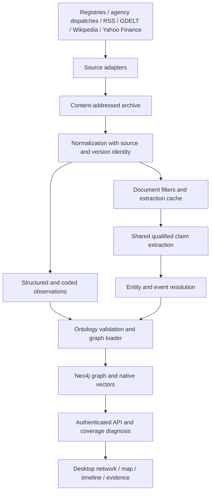

> Core product specification, including integrated news intelligence (D-79).
> This document specifies the complete intended product; implementation status,
> completed packages and remaining dependencies are recorded in [ROADMAP](ROADMAP.md).
> [ARCHITECTURE](ARCHITECTURE.md), [OPERATIONS](OPERATIONS.md) and
> [TESTING_PHASE](TESTING_PHASE.md) describe the shipped runtime and supersede
> legacy runtime/configuration examples. [NEWS_REVIEW](NEWS_REVIEW.md) retains
> investigation evidence; open defects remain in [OPEN_ISSUES](../OPEN_ISSUES.md).

<!-- LIMES — Design Document | v2.0.0 | 2026-07-28 | Status: Maintained -->

# LIMES — Design Document

| Field | Value |
|---|---|
| Document | LIMES — Design Document (Document 1 of 3) |
| Version | 2.0.0 |
| Date | 2026-07-28; reconciled 2026-10-28 |
| Status | Maintained core specification; implementation status in ROADMAP.md |
| Ontology version | 1.0.0 |
| Supersedes | v1.0.0 (2026-07-23), withdrawn |
| Companion documents | Technical Specification v2.1.0; Desktop Client Requirements v1.0.0 and Desktop Client Architecture v1.0.0 |

## Revision History

| Version | Date | Changes |
|---|---|---|
| 1.0.0 | 2026-07-23 | Initial issue. Withdrawn — see below. |
| 2.0.0 | 2026-07-28 | Clean re-issue for a from-zero restart. The v1.x document set accumulated fifteen defects of two kinds: seams specified without a named constructor or invoker (twelve), and sections designing against constraints stated earlier in the same document set (three). Three were found by a coding agent during implementation, twelve by a call-trace audit afterward. All are resolved at source here rather than by revision. Substantive changes from v1.0.0: §7 no longer claims database-enforced read-only separation, which Neo4j Community cannot provide (C-01); §4.14 adds the composition root as a named component; §5.5 distinguishes pre-resolution from resolved assertions; §4.7 assigns node creation to the loader. |
| 2.0.0 | 2026-08-01 | Companion-document references updated for the v2.1.0 amendments (Technical Specification v2.1.0, Implementation Roadmap v2.1.0 — the §5.6 `label_embedding` merge stamp and WP-25a). No substantive change; the design decisions this document records are unaffected. |

### Why v1.x Was Withdrawn

The v1.x documents passed every internal-consistency check: complete traceability from requirement to scope item to work package, an acyclic dependency graph, a full coverage matrix, no contradictions found by cross-reference. Implementation stalled three times regardless.

The checks all had one blind spot. A specification whose modules cannot reach each other satisfies every one of them. Traceability proves the roadmap covers the specification; it proves nothing about whether the specified system runs.

This document set adds one artifact to close that: **Technical Specification §15, a seam register derived from end-to-end call traces.** Every cross-module handoff has a named constructor or invoker, and every primary runtime path is traced from entry point to committed state before the specification is delivered. The register is built from the call graph, not from the module list — building it from the module list is what produced the second round of defects after the first was fixed.

### Reversibility Tags

Design decisions in §10 carry a reversibility tag:

- **R1** — reversible within a session. Configuration, thresholds, prompts, UI arrangement.
- **R2** — reversible with a bounded migration. Schema additions, new adapters, storage layout.
- **R3** — effectively irreversible without rebuilding a substantial portion. Storage engine, core data model semantics, provenance design.

---

## 1. Overview and Goals

### 1.1 What LIMES Is

LIMES is a single-operator, ontology-driven research platform for German and European policy and geostrategic analysis. Official registries, agency dispatches, curated German- and English-language reporting and GDELT coded observations feed one evidence-backed world model. Shared entity and event resolution connects institutional relationships with proposals, announcements, denials and later documented outcomes. A native desktop workspace provides network, geographic and temporal investigation through the authenticated API.

It follows the data-fusion and link-analysis paradigm, not the business-intelligence one. It does not count transactions. It records that a specific corporation was a subsidiary of a specific parent during a specific interval, according to a specific source, with a specific confidence — and lets the operator traverse outward from there.

The scope remains **German and European policy**, including relevant companies
and people outside Germany. Comprehensive, comparable coverage of all 27 member
states is deferred to a possible later version. EU-level sources do not establish
complete national coverage; Germany-specific acquisition and DE/EN language limits
remain explicit. Wikipedia context and Yahoo Finance enrichment are accepted
planned inputs (BE-46), not currently shipped adapters.

### 1.2 Goals

| ID | Goal |
|---|---|
| G-01 | A standing analytical instrument the operator can query about German and EU policy over months, with the dataset accumulating rather than being rebuilt. |
| G-02 | Confront and solve, at proof-of-concept scale, the three engineering problems characteristic of this system class: ontology design, entity resolution, temporal provenance. |
| G-03 | Support open-ended, unanticipated exploration. The operator's questions are not known in advance and will change. |
| G-04 | Make every displayed claim traceable to its source, its extraction provenance, and where applicable the exact sentence that produced it. |
| G-05 | Measure inference usage and cost; bound ingestion work explicitly without a monetary governor. |
| G-06 | Run entirely on local Docker Compose while remaining deployable to a 12 GB host without architectural change. |
| G-07 | Serve, secondarily, as a demonstrable artifact. Explicitly lower priority; constrains no decision in this document. |

### 1.3 Success Criteria

1. The operator can pose a multi-hop question in natural language, receive executable Cypher, inspect it, run it, and receive either results or a diagnosis of which hop the data could not satisfy.
2. Every edge carries source, temporal validity, and confidence; the UI can display the originating sentence for any news-extracted assertion.
3. A model or prompt version change is a versioned, re-runnable, costed event with a measurable effect on extraction quality.
4. Registry records, coded observations and individual news dispatches can be compared with their evidence, source dependence, temporal precision and coverage gaps visible.
5. A proposal, denial or announcement remains distinguishable from a completed event; a corrected dispatch preserves what was known before its correction.

---

## 2. Requirements Summary

### 2.1 Functional Requirements

| ID | Requirement | Trace |
|---|---|---|
| FR-01 | Ingest structured data from official registries via deterministic parsers, with no paid inference. | CA |
| FR-02 | Ingest agency dispatches and curated DE/EN reporting; extract typed entities, events and qualified claims through the shared pipeline. | OR |
| FR-03 | Map all ingested data onto a declarative, versioned ontology; reject any assertion violating it. | CA |
| FR-04 | Resolve entity mentions across sources and languages to canonical entities, non-destructively and reversibly. | OR |
| FR-05 | Record every assertion bitemporally: validity interval and belief interval, independently queryable. | CA |
| FR-06 | Preserve source/version lineage, extraction provenance, exact text spans or coded row locators, attribution, modality, assessment and temporal precision on assertions. | CA |
| FR-07 | Retain contradictory assertions from different sources; expose a query-time trust ranking. | CA |
| FR-08 | Natural-language querying that generates Cypher, validates it against the ontology deterministically, plans it, then executes it read-only. | CA |
| FR-09 | A query builder generated from the ontology, offering only relations valid for the selected domain and range. No hand-authored templates. | CA |
| FR-10 | Diagnose empty result sets by decomposing the query and reporting which clause emptied it, with graph-wide counts. | CA |
| FR-11 | Attach a coverage report to every result: contributing sources, per-relation-type edge counts, per-source last-refresh timestamps. | CA |
| FR-12 | Three synchronized views over query results: network graph, map, timeline. | OR |
| FR-13 | Display the generated Cypher for every query; permit editing and re-execution. | PDD |
| FR-14 | Persist every executed query with its natural-language form, generated Cypher, ontology version, result count. | CA |
| FR-15 | Meter and ledger every paid API call; expose explicit work limits and deferred work. | CA |
| FR-16 | Gate paid extraction behind deterministic filters: content-hash deduplication, local NER pre-filter, passage selection. | CA |
| FR-17 | Cache extraction results keyed by content hash, prompt version, schema version, model identifier. | CA |
| FR-18 | Submit ingestion through authenticated operator jobs; external timers may submit the same bounded jobs. No internal scheduler service. | OR |
| FR-19 | Evaluate extraction quality against a hand-labeled gold set; gate version changes on non-regression. | CA |
| FR-20 | Acquire revision-linked DE/EN Wikipedia entity context through the existing archive and document pipeline (BE-46). | OR |
| FR-21 | Enrich relevant listed companies from Yahoo Finance with available governance, shareholder structure and financial-report metadata, preserving dates, identity and missing-data semantics (BE-46). | OR |

### 2.2 Non-Functional Requirements

| ID | Requirement |
|---|---|
| NFR-01 | Total resident memory of all services must not exceed 11 GB, targeting a 12 GB host. |
| NFR-02 | Total storage footprint under 100 GB including the raw document archive. |
| NFR-03 | Record inference usage, latency and cost; use cheap filters and explicit workload limits. |
| NFR-04 | No component may depend on a GPU. |
| NFR-05 | All ingestion must be idempotent. Re-running over the same input must not duplicate entities or edges. |
| NFR-06 | Typed environment/split-file configuration with declared bind paths and named mutable volumes; no hardcoded credentials. |
| NFR-07 | UI language is English. Source text displayed verbatim in its original language. |
| NFR-08 | Deliverable documents, the ontology, and the gold set carry independent semantic version lines. |
| NFR-09 | Every specified module, function, and type has at least one specified caller or constructor. Verified by Technical Specification §15. |

### 2.3 Constraints

| ID | Constraint | Honored by |
|---|---|---|
| C-01 | Storage engine is Neo4j 2026.x Community Edition. Single database, **no role-based access control**, no online backup. | §7.2, §8.5 |
| C-02 | Paid inference routed exclusively through OpenRouter. | §4.5 |
| C-03 | Runtime is Docker Compose on a single host. No orchestrator, no cloud services. | §8.1 |
| C-04 | Backfill of unstructured sources reaches 90 days. Structured sources backfill fully. | §9.2 |
| C-05 | Optional local Ollama/large-model paths are development-only; portable extraction uses worker-local spaCy and remote inference. | §8.2 |
| C-06 | Neo4j spatial supports points, distances, bounding boxes only. No polygon operations. | §5.7 |
| C-07 | **Every CLI invocation is a fresh operating-system process.** No module-level state survives between commands. | §4.14, §5.9 |

C-01 and C-07 are the two constraints the v1.x set violated after stating them. C-01's absence of RBAC was stated in v1.0.0 §2.3 and then contradicted by a security architecture built on differentiated database privileges. C-07 was implicit and unstated, and produced a cross-process lookup that no invocation could read. Both are now stated as constraints and carry an explicit honoring section.

### 2.4 Non-Goals

| ID | Non-Goal |
|---|---|
| NG-01 | Multi-user account management; consumer/operator bearer authentication remains required. |
| NG-02 | A separate scheduling service, standalone news utility or separate event-ledger application. |
| NG-03 | Personal-data scoping, retention policy, pseudonymization. |
| NG-04 | Unlicensed paywalled acquisition, OpenCorporates, X/Twitter and satellite imagery. Agency access requires selected provider terms and credentials. |
| NG-05 | Quantitative economic time series. |
| NG-06 | PostGIS or any polygon-capable spatial engine. |
| NG-07 | Production deployment, high availability, distribution of the artifact. |
| NG-08 | Hand-authored query templates. |

---

## 3. System Architecture

### 3.1 Style

Four layers with downward dependencies and a composition root construct one
integrated system. Adapters acquire registry data, agency dispatches, RSS entries
and coded GDELT exports. The worker archives originals, normalizes independent
structured/document channels, filters and extracts qualified claims, resolves
entities/events, validates the ontology and loads Neo4j. Neo4j-native vectors
supply identity candidates; no separate vector store is required. User-facing
components access the graph only through the authenticated API.

### 3.2 Two Asymmetric Ingestion Paths

Structured registries supply deterministic observations about ownership,
sanctions, contracts and office-holding. News reporting supplies attributed claims
and developments registries do not publish. GDELT supplies machine-coded secondary
observations, with different provenance and error characteristics from article
text. These are core inputs to the same world model.

A normalized record may carry both deterministic assertions and documents. Process
both channels explicitly: gate rejection, cache hits or empty document extraction
must never discard structured evidence. Define independent checkpoints, counters,
retry and reextract ownership; partial failure must neither hide a channel nor
retract the other's assertions. Parsing confidence does not establish factual
truth. Source dependence and disagreement remain available to queries.

Wikipedia supplies secondary reference context, with article revision identity.
Yahoo Finance supplies secondary company observations. Neither is an official
registry or independent corroboration of underlying reused reports. Their planned
integration is specified in §3.6; BE-46 owns implementation and acceptance.

### 3.3 Container Topology

| Service | Purpose | Publication |
|---|---|---|
| `neo4j` | Graph, native vectors and private backup supervisor | No host publication |
| `api` | Authenticated queries and durable operator-job submission | Loopback HTTP, HTTPS or SSH tunnel remotely |
| `worker` | Adapters, extraction, resolution, loading and bounded jobs | No host publication |

All services run unprivileged. The native PySide6 desktop is an API consumer,
not a fourth service. Consumer and operator tokens are separate; physical backup
uses private authenticated HTTP. ARCHITECTURE and OPERATIONS give current settings.

### 3.4 Data Flow: Structured Source

Composition root builds the run context → adapter fetches → raw payload archived under its content hash → normalizer maps records to ontology-typed assertions carrying fully-identified endpoints → loader validates against the ontology, materializes entity nodes, merges relationships bitemporally.

For fully identified registry records, no paid call or entity resolution is
required: identity comes from deterministic keys computed by the adapter. BE-46
company observations carrying only holder/officer names require the resolver
before loading; deterministic parsing itself never needs paid inference.

### 3.5 Data Flow: Unstructured Source

Adapter fetches → document archived → normalizer preserves dispatch/version identity, text, language, publication/update time and source lineage → gate discards documents already extracted under the current version triple, runs local spaCy NER, discards passages below the mention threshold → surviving passages batched into schema-constrained extraction calls with usage accounting and explicit workload limits → extractor returns **pre-resolution assertions carrying mentions, not identified entities** → resolver converts mentions to identified endpoints, minting new identities where none match → loader validates, materializes, merges.

The distinction between pre-resolution and resolved assertions is load-bearing and is why §5.5 defines two types. The extractor cannot assign identity; resolution is what does.

---

### 3.6 Entity context and company enrichment — BE-46

Two adapters join the existing worker, registry, archive, resolver, ontology,
loader and authenticated API. They introduce no service or separate data store.
Acquisition is bounded by explicit entity/company selections, page sizes and
request limits, with retry/backoff and manual replay of failed jobs. Fetches run
as operator jobs, never as hidden network work in a read-only entity query.

**Wikipedia (`wikipedia`).** Resolve a selected entity through a verified Wikidata
QID and language sitelink where available; ambiguous names, missing pages and
missing sitelinks remain explicit misses. Extend the existing Wikidata identity
contract where needed, including Corporation QIDs, through a reviewed ontology
migration; a ticker or article title alone cannot merge entities. Retrieve DE/EN
article text through MediaWiki, retaining page ID, revision ID/time, language,
canonical and revision URLs, attribution/license and retrieval time. Archive the
payload and bind each text version to its revision. Article context remains
available even when the extraction gate emits no relationships. Any extracted
claims use shared extraction, resolution and provenance with exact revision/span
evidence; article text is never promoted directly into authoritative facts.

**Yahoo Finance (`yahoo_finance`).** Use Yahoo Finance as the selected provider,
with a pinned, replaceable `yfinance` transport inside the adapter. Map the company
separately from its securities/listings: exchange-qualified ticker, provider
identifier, ISIN/LEI where supplied and verified links to canonical entities.
Multiple listings must not create duplicate companies or conflate share classes.
Unresolved company, holder and person matches remain candidates rather than
forced merges. Deterministic parsing is free of paid inference; unresolved names
use the existing resolver before the loader writes observations.

Retrieve available company profile, officers and board membership/structure,
major/institutional/fund holdings, ownership summaries, earnings dates and report
metadata. Preserve executive versus director/supervisory roles as supplied; an
executive roster cannot establish a complete board or inferred committee structure.
Financial-report metadata includes fiscal period, report kind, publication date
and source link when supplied; an estimated earnings-calendar date is not an
actual report publication. This does not expand into economic time-series analysis.

**Shareholder structure** includes named holder-to-issuer holdings with shares,
percentage, value/currency, security/share class and provider reporting/as-of date
where supplied. Aggregate insider/institutional/free-float figures are separate
observations, not named-holder edges. Retain percentage basis (shares, float or
voting rights) and units; unknown basis stays unknown. Do not sum overlapping fund
and institutional lists, assume the displayed holders exhaust ownership, infer
ultimate beneficial ownership or control, or confuse a fund manager with a fund.
Preserve direct versus indirect interests only when the source distinguishes them.

Version the ontology, assertion/property model, loader, resolver keys and API
contracts together: today's coarse DIRECTOR_OF and OWNS_STAKE_IN edges cannot
alone retain these roles, quantities and dates. Validate available upstream fields
before freezing exact schema names. Distinguish source publication, reporting/as-of,
retrieval and graph recording times; unknown role start dates stay unknown. Snapshot
disappearance, a failed request or a partial response never proves a resignation,
sale or zero holding. Reconcile snapshots only under an explicit same-source,
same-section completeness rule, preserving prior evidence and contradictions.

BE-46 implements ontology 1.2.0 with immutable `EnrichmentSnapshot` and
`EnrichmentObservation` artifacts. Typed properties include role/term dates, numeric
shares/ratios/value, units/basis/currency, source dates and exact section/row
locators. Four non-temporal connections link selected entities to snapshots,
snapshots to observations, companies to `SecurityListing` and reviewed listings
to ISIN-identified `Security`. Existing entity/edge stamps remain intact; same-major
additive migration provisions constraints/indexes through the existing lock.
`EnrichmentCheck` retains each acquisition manifest/check time independently.

Company/QID/listing selections require an operator-reviewed evidence URL and
rationale; Yahoo's returned price symbol/exchange must match before other sections
are acquired. QID mappings reuse canonical registry company IDs during resolution.
Unidentified holder/officer names enter the shared conservative candidate resolver;
no name-only identity becomes a canonical person, fund or company. Security/ISIN
and share-class mappings are separately optional reviewed claims, not guesses
from a company name or ticker suffix. Wikipedia validates the QID on the actual
DE/EN revision page; redirect chains and ambiguity remain visible.

No provider section asserts exhaustive ownership or board coverage. Completeness
is always false for these partial surfaces, so no missing row closes any interval.
Unchanged versions replay idempotently; subsequent checks update acquisition
history without replacing source data. Section failures retain available sections
and prevent the run checkpoint from advancing. Operators inspect then replay.
The API exposes source dates separately from last check and labels freshness based
only on acquisition when source freshness is unknown. Wikipedia wikitext remains
available without inference; optional extraction uses qualified prompt/schema 2.0.0
and the shared pipeline, never direct factual edges.

Wikipedia accepts all existing ontology entity types with reviewed QIDs, including
countries/places; Yahoo selects corporations only.

Both adapters retain source-specific trust and provenance; they do not inherit
Wikidata's or official registries' trust ranks. Their ranks are Wikipedia 0.65 and Yahoo Finance 0.70; neither establishes official authority. API evidence/coverage responses expose available,
missing, unsupported, stale and failed sections plus scope and dates; graph-wide
counts are not measures of country or shareholder completeness. Existing desktop
access remains through the API; parity/consumer compatibility is part of BE-46.

---

## 4. Component Responsibilities

### 4.1 Source Adapter
**Owns:** fetching from one source; declaring its identity, trust rank, incremental capability, backfill capability; emitting raw payloads and normalized records.
**Does not own:** entity resolution, cross-source deduplication, **any write to the graph**.

### 4.2 Raw Archive
**Owns:** durable, compressed, content-addressed storage of every fetched payload; being the system of record from which the entire graph is re-derivable.
**Does not own:** search, indexing, serving read traffic.

### 4.3 Normalizer
**Owns:** converting source records into ontology-typed assertions; language detection; timestamp normalization; text extraction from markup.
**Does not own:** judging whether an assertion is true, novel, or worth keeping.

### 4.4 Gate
**Owns:** content-hash deduplication against the extraction cache; local spaCy NER; passage selection by mention density; ensuring nothing reaches the extractor that a free filter could reject.
**Does not own:** relation extraction.

### 4.5 Extractor
**Owns:** producing qualified pre-resolution claims and events from passages via a schema-constrained OpenRouter call; distinguishing reported propositions, denials, proposals and completed outcomes; attaching model, prompt version, schema version, confidence, evidence span; writing every call to the cost ledger.
**Does not own:** entity identity, resolution, any graph write.

### 4.6 Entity Resolver
**Owns:** converting mentions to identified endpoints; matching event candidates using source namespace, actors/roles, type, time precision and location. Labels or dates alone never justify a merge; unresolved alternatives remain visible. Deterministic identifiers take absolute precedence and short-circuit everything. Otherwise: embed, retrieve candidates by vector similarity, adjudicate where ambiguous, mint a new identity where nothing matches.
**Does not own:** destructive merging. No node is ever absorbed or deleted. A merge is a link; unmerging is retracting it. **The resolver mints identities but does not write entity nodes** — it returns identified endpoints and the loader materializes them, so a new entity is created in the same transaction as the assertion justifying it.

### 4.7 Graph Loader
**Owns:** validating every assertion against the ontology; **materializing canonical entity nodes**; stamping ontology version; idempotent bitemporal merge; closing superseded validity intervals; materializing reference-data lookup rows. **Sole writer of ontology-typed nodes and relationships.**
**Does not own:** resolving contradictions. Contradictory assertions from distinct sources are both written.

### 4.8 Ontology Registry
**Owns:** loading and self-validating the declarative ontology; exposing types, relations, and domain/range constraints to the loader, the Cypher validator, the builder projection, and the API.
**Does not own:** migration execution.

### 4.9 Usage and Cost Accounting

**Owns:** passive durable recording of provider tokens, model, purpose and cost
through CostRecorder and the ledger. There is no monetary governor. Workload
limits, prioritization and deferred-item accounting belong to ingestion orchestration;
their remaining implementation is BE-43. Legacy budget arguments are ignored.

### 4.10 Query API
**Owns:** being the only path to the graph for user-facing components; validating all operator-supplied Cypher before execution; serving ontology metadata; assembling coverage reports; persisting executed queries.
**Does not own:** rendering, layout, presentation.

### 4.11 NL-to-Cypher Service
**Owns:** generating candidate Cypher from a question and the serialized ontology; submitting it to deterministic validation; one bounded regeneration on failure; plan-gating before execution.
**Does not own:** executing the query, or asserting the result is correct.

### 4.12 Coverage and Diagnosis Service
**Owns:** computing contributing sources, graph-wide relation counts, and source refresh timestamps for any query; decomposing empty queries to identify the clause that emptied the set.
**Does not own:** rewriting queries to produce results.

### 4.13 Desktop Workspace

**Owns:** the native PySide6 desktop workspace, synchronized selection and
network/map/timeline views, ontology-generated builder, editable Cypher, coverage
and versioned provenance. Every query and operation uses authenticated HTTP.
Session credentials never enter profiles. The desktop has no graph driver or
extraction code. Dash code remains for compatibility but is not shipped as a
service. The desktop architecture and DC roadmap specify its implementation.

### 4.14 Composition Root

**Owns:** constructing every component the system needs, in dependency order, once per process. With the documented API startup exception, it is the only module that instantiates a driver, a registry, an archive, a cost recorder, an extractor, or a gate.

**Does not own:** any business logic. It builds and hands off.

This component exists because C-07 makes every CLI invocation a fresh process, and because the v1.x design specified modules and interfaces without naming who constructed them — the defect that stalled implementation three times. A single named construction site makes "who builds this" answerable by reading one file.

---

## 5. Data Model

### 5.1 Ontology Principles

The ontology is a declarative artifact under independent semantic versioning, not conventions embedded in code. It defines entity types, supertypes, identifying keys, properties, and every relation with explicit domain and range. It is loaded at startup, self-validated, and consumed by four components.

Every node and edge records the ontology version under which it was written, so a schema change leaves older data queryable and unambiguously identifiable.

### 5.2 Entity Types

Twenty-three concrete types under three abstract supertypes (ontology 1.3.0). Supertypes make traversal expressible without enumerating subtypes.

| # | Type | Supertype (— = none) | Identifying key |
|---|---|---|---|
| 1 | `Person` | `Agent` | Wikidata QID; Bundestag ID; else resolved |
| 2 | `PublicBody` | `Agent` | Wikidata QID; TED buyer ID; else resolved |
| 3 | `Corporation` | `Agent` | LEI; German register number; reviewed Wikidata QID; else resolved |
| 4 | `PoliticalParty` | `Agent` | Wikidata QID |
| 5 | `IGO` | `Agent` | Wikidata QID |
| 6 | `InterestGroup` | `Agent` | EU Transparency Register ID |
| 7 | `Country` | `Place` | ISO 3166-1 alpha-2 |
| 8 | `AdministrativeRegion` | `Place` | NUTS code |
| 9 | `Location` | `Place` | GeoNames ID; else coordinate hash |
| 10 | `LegalAct` | `Artifact` | CELEX; Bundesgesetzblatt citation |
| 11 | `Contract` | `Artifact` | TED notice ID |
| 12 | `Document` | `Artifact` | Content hash |
| 13 | `Sanction` | `Artifact` | FSD ID plus regime |
| 14 | `Asset` | `Artifact` | OSM ID |
| 15 | `Event` | — | Source event ID plus timestamp |
| 16 | `Office` | — | Body ID plus title plus interval |
| 17 | `Topic` | — | Vocabulary plus code |
| 18 | `NewsDocument` | `Artifact` | Archived document ID |
| 19 | `NewsClaim` | `Artifact` | Qualified claim ID |
| 20 | `EnrichmentSnapshot` | `Artifact` | Source/selection/section/content identity |
| 21 | `EnrichmentObservation` | `Artifact` | Snapshot plus source-row identity |
| 22 | `Security` | `Artifact` | Reviewed ISIN |
| 23 | `SecurityListing` | `Artifact` | Provider/exchange/symbol |

`Office` is reified rather than expressed as a property because questions of the form "who held this position when that act was adopted" require the interval to be a joinable object. This is the most consequential modeling choice in the ontology.

`Asset` criticality is a controlled attribute against the German KRITIS sector taxonomy, not a subtype hierarchy.

### 5.3 System Node Types

Not ontology entities, excluded from the type count, each with exactly one owning writer (Technical Specification §15):

`Source`, `IngestionRun`, `ExtractionCacheEntry`, `CostLedgerEntry`, `SavedQuery`, `GoldSetItem`, `PostalCode`, `Mention`, `AdvisoryLock`, `EventMatchReview`, `EnrichmentCheck`.

`PostalCode` exists because of C-07: the postal-code-to-NUTS correspondence is produced by one source and consumed by three others in separate processes, so it lives in the graph rather than in module state or a derived file.

### 5.4 Relation Types

Thirty-six relations. BE-47 adds direct and ultimate financial consolidation; BE-46 added four evidence/listing connections to the thirty historical relations. The original count reached thirty because `SANCTIONED_BY` is decomposed into `TARGETS`, `IMPOSED_BY`, and `ESTABLISHED_BY` — a sanction's target, its imposing authority, and its establishing instrument are three facts with three sources and three validity intervals.

`MEMBER_OF`, `HOLDS_OFFICE`, `OFFICE_AT`, `DIRECTOR_OF`, `OWNS_STAKE_IN`, `SUBSIDIARY_OF`, `HEADQUARTERED_IN`, `LOCATED_IN`, `PART_OF_REGION`, `TARGETS`, `IMPOSED_BY`, `ESTABLISHED_BY`, `ADOPTED`, `AMENDS`, `REPEALS`, `CITES`, `APPLIES_TO`, `AWARDED_TO`, `BUYER_OF`, `SUPPLIES`, `LOBBIES_FOR`, `MET_WITH`, `PARTICIPANT_IN`, `ACTOR_IN`, `TARGET_OF`, `OCCURRED_IN`, `OPERATES`, `ABOUT_TOPIC`, `MENTIONS`, `REPRESENTS`.

`HAS_ENRICHMENT`, `HAS_OBSERVATION`, `HAS_LISTING` and `REPRESENTS_SECURITY` are non-temporal evidence/identity connections. Snapshot and observation properties carry their independent source and recording dates.

`DIRECTLY_CONSOLIDATED_BY` and `ULTIMATELY_CONSOLIDATED_BY` connect corporations for financial accounting consolidation. Neither asserts share ownership, legal subsidiary status or an ownership percentage.

Domain and range for each are specified in Technical Specification §5.4 and are authoritative in the ontology artifact.

`ACTOR_IN`, `TARGET_OF`, and `PARTICIPANT_IN` are deliberately distinct: GDELT encodes directional asymmetry, the Transparency Register encodes symmetric attendance. Collapsing them into a role property discards what makes event data useful.

### 5.5 Two Assertion Types

A single assertion type cannot span the pipeline, because extraction produces mentions and only resolution produces identity.

**Pre-resolution assertion** — what the extractor returns. Endpoints are mentions: a surface string, an inferred type, and optionally a deterministic key found in the text.

**Resolved assertion** — what the loader accepts. Endpoints are identified: a stable entity identifier, a concrete type, a label, a deterministic key where one exists, and aliases.

The converter between them is a named module owned by the resolver. In the structured path adapters produce resolved assertions directly, because deterministic keys make identity computable without inference.

### 5.6 Assertion Metadata

Every relationship, and every node property not derived from a deterministic key, carries: `assertion_id`, `valid_from`, `valid_to`, `recorded_at`, `retracted_at`, `source_id`, `source_trust`, `confidence`, `extractor_model`, `prompt_version`, `schema_version`, `ontology_version`, `evidence_document_id`, `evidence_start`, `evidence_end`.

Nothing is deleted. A sanction being lifted sets `valid_to`. An extraction error being corrected sets `retracted_at`. The two are independent, which makes both "who controlled this company in March 2025" and "what did the graph believe in March 2025" answerable. The second is how extraction quality is measured over time.

Text evidence identifies an immutable dispatch version and exact span; coded
evidence identifies the archived export, row/event and report URL. One dispatch
may support multiple assertions and several dispatches may support one event.
Retain provider/external ID, canonical URL, original-agency/syndication lineage,
publication/update times and correction links. Syndicated copies are not
independent corroboration. SOURCEURL alone is not archived article content;
synthetic actor/code summaries must not masquerade as source prose.

Qualified assertions preserve these independent dimensions:

| Dimension | Required semantics |
|---|---|
| Statement kind | Observation, attributed claim, announcement or denial, with its proposition retained |
| Modality | Actual, proposed, planned or conditional |
| Attribution | Report author/agency separate from named or unnamed speaker; unknown stays unknown |
| Assessment | Unassessed, supported or disputed, with supporting evidence and assessment rule/version |
| Event type and lifecycle | Proposal, negotiation, agreement, completion or cancellation; distinguish transitions from different events |
| Temporal precision | Instant, day, approximate interval or unknown, independently of validity and recorded time |

A faithfully extracted denial can have high extraction confidence without proving
or disproving its proposition. Announcing a proposed merger does not establish a
completed merger. Event identity is namespaced; source IDs are not global event
identities. Ontology evolution supplies these semantics alongside existing Event
keys, not a competing ontology or assertion store. Publication, retrieval,
occurrence and `recorded_at` remain distinct; unknown occurrence time is not
silently replaced by publication/fetch time. Corrections preserve prior versions
and contradictions. Extraction confidence, source trust and corroboration must
remain independently inspectable.

### 5.7 Bitemporal and Node Semantics

Node materialization precedes relationship merge in the same transaction. A partial batch can leave neither an edge without endpoints nor an endpoint without its justifying edge. Node merge is non-destructive: an existing label, deterministic key, and original ontology version are never overwritten, so a lower-trust source cannot degrade an entity a higher-trust source established.

Interval closure is scoped strictly to a single source. Closing across sources would destroy the disagreement between them, which in this domain is frequently the signal.

Geography is stored as points. Region membership is assigned at ingest through the postal-code correspondence, never computed from geometry — which is what keeps a polygon-capable engine out of scope (C-06, NG-06).

### 5.8 Source Trust Ranking

| Rank | Sources |
|---|---|
| 1.00 | GLEIF, EUR-Lex, EU FSD, TED, Transparency Register, Bundestag DIP, Gesetze im Internet, GISCO/NUTS |
| 0.90 | Wikidata |
| 0.75 | OpenStreetMap |
| 0.70 | Commission RAPID, Bundesregierung releases |
| 0.60 | Curated news outlets |
| 0.50 | GDELT |
| 0.30 | OffeneRegister |

OffeneRegister sits at the bottom deliberately. Its data is materially stale, and it records the dataset's own publication date as `recorded_at`, not the ingestion timestamp. With honest vintage, low trust, and reversible merges, stale data is safely representable; no free current alternative exists for German directorships.

The existing ranking heuristic multiplies source trust and extraction confidence for ordering only. Both components remain inspectable; that score does not establish truth, independence or corroboration. Qualified assessment carries its own evidence and rule/version.

### 5.9 Cross-Process State

C-07 prohibits depending on globals between commands. Domain reference lookups,
assertions, caches and ledger entries live in Neo4j; originals live in the archive.
The operational queue explicitly uses local SQLite, model pins use locked atomic
files on their named volume, and desktop profiles use XDG config without tokens.
Each has one declared owner and durable lifecycle; no implicit process state
becomes a second source of entity identity.

---

## 6. API and Interface Design

### 6.1 Surface

The API is the only path to the graph. It serves operational endpoints, entity and search endpoints, three query paths, coverage, saved queries, and the cost ledger. Full specification in Technical Specification §6.

### 6.2 Natural-Language Query Contract

Four stages; the second is deterministic, and that is what makes the approach safe.

**Generate** — the complete serialized ontology, roughly 1,500 tokens, is supplied with the question. The small closed ontology is why this is tractable; this is not text-to-SQL against a large warehouse.

**Validate** — every label and relation must exist; every relation must satisfy declared domain and range; write clauses and side-effecting procedures are refused by parse-level inspection; a limit is injected if absent. On failure, exactly one regeneration with the reason supplied.

**Plan** — `EXPLAIN` runs before execution. Cartesian products and unbounded expansions are rejected with the plan shown, rather than exhausting an 11 GB envelope.

**Execute and report** — the generated Cypher is always returned and always editable. Every result carries a coverage report. Empty results trigger diagnosis automatically.

### 6.3 Empty-Result Diagnosis

An empty result is the characteristic failure of this system class, because absence of evidence reads as evidence of absence. Each `MATCH` clause is executed independently and the first that returns nothing is reported, with graph-wide counts for the relation types involved. An empty result without that report is a false statement about the world carrying the operator's name.

### 6.4 Generated Query Builder

Rendered from the ontology at runtime, not authored. Selecting a type offers only relations its domain admits, then only types their range admits, then filters from declared property types, then optionally another hop. Temporal qualifiers are offered on every temporal relation. It cannot construct an invalid query and costs nothing per use.

No query templates exist anywhere in this system (NG-08). Templates encode anticipated questions; the instrument exists for unanticipated ones.

### 6.5 UI Structure

A native PySide6 exploration workspace synchronizes network, map and timeline
views over a shared selection, with NL questions, editable Cypher, generated
builder, coverage, provenance and saved queries. Views expose attributed versus
documented claims, proposed versus completed developments, speaker/source,
disputes, time precision and dispatch versions. Follow a proposal through denial,
agreement and later registry/award confirmation, inspecting evidence at each
step. Switch validity and recorded time without turning chronology into causality
or evidence of coordination. The desktop owns neither database access nor
ontology literals; response schemas come from the API.

### 6.6 Command Line

Operator jobs expose ingest, backfill, reextract, model selection, evaluation,
migration, backup and embedding maintenance through authenticated HTTP. Stack
administration is separate. External timers submit the same bounded jobs and
observe completion, preserving request UUIDs after uncertain responses. No
standalone extractor is installed. Legacy budget flags are ignored.

---

## 7. Security Architecture

### 7.1 Threat Model

Single operator, single host, no network exposure beyond loopback, no untrusted users. Authentication, authorization, session management, and tenant isolation are non-goals (NG-01). Four real concerns remain, none about users.

### 7.2 Read-Only Enforcement — and What C-01 Costs

**Neo4j Community Edition has no role-based access control (C-01).** Additional users can be created; their privileges cannot be restricted. There is no read-only role to grant. The v1.x design specified database-enforced privilege separation and made it an enforcement layer, which was not implementable on the chosen engine — a section designing against a constraint stated four sections earlier.

What is actually available, in order of strength:

1. **Parse-level rejection.** All operator-supplied and generated Cypher is refused if it contains a write clause, a side-effecting procedure, or an unallowlisted procedure call. Detection is by inspection of the parsed statement, not substring search. This is the primary defense and the only one that inspects intent.
2. **Driver access mode.** Query-path sessions are opened with read access mode, so the driver refuses writes client-side. Weaker than a server privilege — code in the API process can open a write session — but it is a real second barrier against a validator defect, which is the actual failure mode of concern.
3. **Bounded writes.** Query paths write usage records and saved queries through parameterized code. Dedicated operator endpoints additionally write the local durable job queue; authenticated allowlisted commands run in the worker. Query input cannot select arbitrary commands or bypass validation. The old exact-three-writes count does not constrain this separate operational surface.

**Residual risk, stated plainly:** a defect in the Cypher validator combined with a defect in session-mode selection can write to the graph. On Community Edition this cannot be prevented by the database. For a single-operator local system with no untrusted input path other than ingested documents, this is accepted. It is recorded here rather than concealed behind a privilege claim the engine cannot honor.

### 7.3 Untrusted Ingested Content

The most substantive security property. LIMES ingests arbitrary public text and passes it to a model that produces assertions the operator will later trust. Mitigations, layered: document text is supplied as explicitly delimited data, never concatenated into the instruction portion; extraction calls carry no tool definitions; output is schema-constrained; every assertion is validated against the ontology before it can reach the graph; every surviving assertion carries its evidence span and source, so an injected claim is traceable to the sentence that produced it and retractable without disturbing anything else.

Injection cannot be prevented at the model layer. It can be made validated, attributed, and reversible.

### 7.4 Secrets and Exposure

All API surfaces, including docs, health and revision, require bearer credentials.
Separate operator credentials authorize job submission/status/output. Desktop
credentials are session-only; remote transport is HTTPS or loopback SSH forwarding.
The API publishes only `127.0.0.1:8000:8000`; database and backup control stay
private. API and worker hold the inference key. Split configuration separates
secrets, tuning and atomic model pins; existing secrets are never printed or
committed. See OPERATIONS for the current configuration and initialization.

### 7.5 Personal Data

Out of scope (NG-03), by operator decision. LIMES stores named natural persons in public roles with inferred relationships between them, and implements no scoping, retention, or pseudonymization. The repository carries a disclaimer stating it is a personal research artifact, with uneven source coverage and no automatic public-person retention policy. Insertion points are reserved — a person-scope predicate in the loader, a display-name indirection in the API response layer — so a later version adds rather than retrofits.

---

## 8. Infrastructure and Deployment

### 8.1 Compose Topology

The base Compose file ships api, neo4j and worker with loopback API publication,
private database/backup ports and named mutable volumes. The development override
mounts source and enables reload; it is never a release recipe. Every service runs
as UID/GID 7474, drops capabilities and disallows new privileges. No Docker socket,
host-control CLI or arbitrary command execution is mounted in services. The API
queues bounded jobs on local SQLite storage; a single worker holds a lifetime lock.
Publication is unchanged by using a remote client. Deploy clean committed source
as recorded immutable image IDs; do not remove the override as a promotion step.

### 8.2 Resource Contract

A 12 GB host and an 11 GB service-resident target remain sizing requirements,
not current measurements. Neo4j heap/page cache and worker-only spaCy must fit the
single-host topology. Only one worker executes jobs; no second worker or Dash
service is part of the resource budget. Ollama/local large models are optional
development paths outside the portable contract (C-05); no GPU is required.
BE-45 must measure full-workload memory, storage and validation latency. Existing
Compose memory settings or mocked tests alone do not satisfy NFR-01/NFR-02.

### 8.3 Storage

Neo4j data 5–20 GB at proof-of-concept scale; the compressed content-addressed archive single-digit GB per year at curated-feed volume. Against 100 GB the retention policy is to keep everything — re-extraction under an improved prompt is a design feature and requires the original bytes.

### 8.4 Configuration

`config/secrets.env`, `config/settings.env` and `config/models.env` separate
credentials, tuning and tool-written pins. Owner-controlled host binds are
read-only; mutable pins live on a named volume and override seeded pins. Empty
environment values are unset. Pin writes validate a model-only allowlist and use
locked atomic replacement; the API refreshes them before its next NL query.
Legacy `.env` loading remains compatibility behavior. No secret content is printed.

### 8.5 Backup

The private Neo4j supervisor serializes authenticated backup requests. It
requires clean shutdown within the 180-second grace, dumps offline, rejects an
empty dump, restarts in a finally block and verifies readiness before success.
The worker requests backup through private HTTP; the desktop submits an operator
job through the API and never invokes Docker or a shell. Graph access is unavailable
during the dump; API and queue remain up. A graph dump does not replace backups
of source archive, models, queue and configuration. Restore validation uses an
isolated stopped database; no automatic production restore is authorized.

---

## 9. Operational Model

### 9.1 Ingestion

Each operator job records source, window, counts, errors, usage, latency and cost.
Agency acquisition requires selected access, retention and display terms. External
timers may submit authenticated jobs only with bounded work, durable per-channel
checkpoints and non-overlapping windows; failed paid work is not replayed
automatically. One dispatch/version remains an archived source document. GDELT
exports retain row identity and report links; optional Mentions associations
expand coverage without fabricating missing article text.

### 9.2 Backfill

Structured sources backfill fully without inference. Text backfill targets the
configured window, subject to provider availability/rights and explicit document,
byte and window limits. Deferred work and reasons remain visible. A timeout is
not a spending cap. GDELT decoding uses the published ZIP/TSV format and complete
column map; geography codes require explicit conversion.

### 9.3 Cost Control

The passive ledger records every paid call. Language/topic filtering, duplicate
detection, prioritization and passage selection precede inference. Explicit work
limits bound a job and retain deferred items; no monetary governor is imposed.
Measure actual workload costs instead of assuming a monthly ceiling.

### 9.4 Re-extraction

A prompt, schema, or model version change invalidates nothing automatically — the cache key includes all three, so the next ingest re-extracts only new content. Deliberate re-extraction is an explicit operator job with a version and bounded work. Superseded assertions are retracted, never deleted, so the graph records what it believed before and after.

### 9.5 Quality Gate

Use a representative, independently annotated DE/EN corpus of entities, events,
claims and evidence. Evaluate extraction fidelity, attribution, modality, temporal
precision, correction/syndication handling and false event merges separately from
truth assessment. Compare value against existing feeds/GDELT on overlapping
coverage. Grow the annotated evaluation pool from acquired investigation evidence; define
justified quality thresholds for measured release qualification, not as a coding
prerequisite. No fixed test quotas.
Version schema, prompt, ontology, caches, resolver/loader and API/desktop mirrors
together, preserving historical meaning. Keep the existing reported-speech
safeguard until every consumer supports qualified claims. Automated tests mock
paid calls; paid corpus measurement remains an explicit operator run.

### 9.6 Ontology Change

Additive changes are minor bumps requiring no migration; existing data remains valid under its stamped version. Breaking changes are major bumps requiring a numbered migration that rewrites the version stamp on affected nodes and edges.

### 9.7 Monitoring

No monitoring stack. The observable surfaces are the run log, the cost ledger, per-source refresh timestamps, and the coverage figures attached to every query. For a single-operator local system these suffice.

---

## 10. Key Design Decisions

| ID | Decision | Rationale | Rejected | Rev |
|---|---|---|---|---|
| DD-01 | Neo4j 2026.x Community as sole storage engine | Graph, vectors, full text, and point geometry in one container; deepest documentation corpus, which improves coding-agent output | Memgraph (memory-first); ArangoDB (AQL forfeits Cypher priors); FalkorDB (thin ecosystem); Postgres+AGE (incomplete Cypher on the load-bearing path); Kùzu (archived Oct 2025) | R3 |
| DD-02 | Bitemporal assertions with mandatory provenance | Distinguishes what was true from what was believed; makes extraction quality measurable and corrections non-destructive | Single-timestamp model — cannot express "held office when the act was adopted" | R3 |
| DD-03 | Contradictions retained, resolved at query time | Two sources disagreeing is frequently the signal | Silent write-time resolution | R2 |
| DD-04 | Non-destructive reversible entity merges | Entity resolution is the acknowledged hard problem; a wrong merge must be undoable | Destructive absorption | R3 |
| DD-05 | Structured backbone carries no paid inference | Eleven of thirteen sources are deterministic parsers producing the highest-value edges; avoids model extraction error for deterministic registry parsing | LLM-first ingestion | R2 |
| DD-06 | Deterministic gating before every paid call | Filters cheaply before inference; actual reduction is measured | Document-level extraction of everything | R1 |
| DD-07 | Passive accounting; explicit workload controls | D-75 removed monetary enforcement; usage remains measurable | Implied protection from ignored budget flags | R1 |
| DD-08 | Cache keyed by content, prompt, schema, model | Makes re-extraction explicit, scoped, and costed | Time-based invalidation | R2 |
| DD-09 | NL querying with deterministic validation, plus ontology-generated builder | The operator explores unanticipated questions; the ontology is small and closed, which is why generation is tractable | Template library at any count; unvalidated generation | R1 |
| DD-10 | Automatic empty-result diagnosis | Absence of evidence reading as evidence of absence is the characteristic failure of this system class | Returning an empty set | R1 |
| DD-11 | Mandatory coverage report on every result | Makes data limits visible at the point of use | Documenting them separately | R1 |
| DD-12 | Region membership assigned at ingest via lookup | Avoids the only geospatial operation Neo4j cannot perform, keeping a second engine out of scope | PostGIS sidecar | R2 |
| DD-13 | `Office` reified as a first-class node | Interval-joined questions are otherwise inexpressible | Office as a relationship property | R2 |
| DD-14 | Authenticated FastAPI and native desktop; Dash retired | Keeps all analyst surfaces behind one API contract with shared selection and typed responses | Streamlit; direct SPA | R1 |
| DD-15 | OffeneRegister at lowest trust with honest vintage | Stale data is safely representable given provenance; no free current alternative for German directorships | Permanent exclusion | R1 |
| DD-16 | Ontology as declarative versioned artifact consumed by four components | One definition rather than four drifting copies | Conventions in code | R3 |
| DD-17 | Bounded operator jobs; external timer submission | One execution path with request identity and manual replay; unattended news waits for work limits | Internal scheduler or separate utility | R1 |
| DD-18 | **Single composition root** | Every CLI invocation is a fresh process (C-07); a single named construction site makes "who builds this" answerable by reading one file. Its absence stalled the v1.x implementation three times | Per-module construction; import-time side effects | R2 |
| DD-19 | **Loader is sole writer of ontology-typed nodes and relationships** | Node identity, labeling, and key stamping in one place, transactionally bound to the assertions that justify them; a new entity cannot exist without its evidence | Adapter-side writes; resolver-side writes | R3 |
| DD-20 | **Domain cross-process reference data lives in the graph** | C-07 makes module state unreachable across commands; the graph already carries provenance and refresh timestamps for everything else | Derived cache file; re-download; config key | R2 |
| DD-21 | **API holds write credentials and the inference key, constrained by an enumerated write surface** | Query generation is paid inference and query persistence is a write; C-01 makes database-enforced separation unavailable, so the enforceable property is that the API's write surface is a fixed, checkable list | Withholding both — makes three specified endpoints unimplementable; claiming database enforcement the engine cannot provide | R2 |

---

## 11. Open Questions and Assumptions

### 11.1 Assumptions

| ID | Assumption | If wrong |
|---|---|---|
| A-01 | Point-level geography suffices; no polygon operations | A PostGIS sidecar keyed by node ID; additive |
| A-02 | Selected provider pricing and volume fit the intended workload | Measure usage and adjust workload limits/prioritization before unattended acquisition |
| A-03 | The gate removes 60–80% of raw volume | Below 40%, the feed set narrows |
| A-04 | Serialized ontology stays near 1,500 tokens | Past ~4,000, generation degrades and argues for retrieval over the ontology |
| A-05 | OSM tagging is adequate for KRITIS categories in Germany | Asset coverage sparse; the coverage report makes it visible |
| A-06 | No GPU available or required | Local model paths unavailable, as already assumed |
| A-07 | Unstructured volume stays at 100–200 items/day | Measure filtering and bound work; expose deferred items |

### 11.2 Open Questions for Document 2

| ID | Question |
|---|---|
| OQ-01 | Pinned model identifiers, selected by measurement rather than assertion |
| OQ-02 | Vector-similarity thresholds separating automatic linkage, adjudication, rejection |
| OQ-03 | Extraction batching and its interaction with evidence-span attribution |
| OQ-04 | Neo4j heap and page cache tuning against the 12 GB envelope |
| OQ-05 | Gold set composition and match semantics |
| OQ-06 | Plan-gate rejection rules: which operators and thresholds |

### 11.3 Known Coverage Limitations

These are source and acquisition limits. The existing coverage report exposes
sources, counts and refresh times, not EU-27 completeness. BE-46 adds explicit
section availability for its new inputs; it does not certify geographic completeness.

1. **Supplier relationships have no structured source.** GLEIF gives ownership, TED gives buyer-to-prime-contractor; neither gives supply chains. Relevant supplier assertions come from news extraction only — sparse, low-confidence, biased toward what was reported.
2. **Current German directorships are structurally weak.** OffeneRegister is stale, Bundesanzeiger is awkward at scale, Wikidata covers only notable executives.
3. **OpenStreetMap acquisition is restricted to the German bounding box**, with uneven completeness and tagging discipline inside it.
4. **National acquisition is Germany-centred.** Other member states do not have equivalent parliamentary, legislation and officer adapters. This is within the confirmed current scope, not complete EU coverage.
5. **Wikipedia and Yahoo Finance are secondary and incomplete.** Wikipedia is limited to available DE/EN articles; Yahoo Finance principally covers listed companies and may omit board roles, holders and report metadata. BE-46 must expose those gaps, including unlisted/unsupported companies, instead of interpreting them as negative facts.

### 11.4 Deferred

Comprehensive EU-27 national and multilingual coverage is deferred to a possible later version. Person-scope predicates and pseudonymization, polygon-capable geography and multi-user accounts remain deferred. External timer submission is in core news scope; bounded recurring acquisition runs inside the existing worker once an investigation is tracked. BE-43 implements dynamic investigation-driven acquisition and an evolving evaluation pool (D-82); user-supplied feeds or a pre-existing corpus are not prerequisites.

## Investigation-driven reporting contract (BE-43 / D-82)

Tracked means an entity or relation is part of an ongoing investigation that LIMES
actively keeps informed about. Tracking is explicit durable investigation state;
viewing an entity is read-only. The existing worker automatically submits bounded
acquisition cycles for active investigations, refreshes current graph labels and
aliases, and sets up DE/EN search feeds for entity names or both relation endpoints.
Edits change future discovery; pause stops future cycles without deleting evidence.
Failed or interrupted jobs require explicit replay. No fourth service is added.

Public Google News RSS supplies discovery metadata, publisher/report links and
headlines/snippets. Only that fixed HTTPS origin is fetched. Arbitrary linked
publisher pages and paywalls are not fetched; no agency subscription or full-text
license is claimed. All original RSS responses, stable entry envelopes and
acquisition manifests are content-addressed in the archive. Whole-feed changes
must not force re-extraction of unchanged entries. Missing publication times and
article text stay explicitly unknown/unavailable. Publisher plus dispatch ID
identifies dependent reporting; versions coexist and correction status stays
unknown unless the source establishes it.

Ontology 1.1.0 adds NewsDocument and NewsClaim artifacts. It is an additive
migration: existing entity/assertion stamps are retained, and old qualifiers are
unknown. New news extraction uses prompt/schema 2.0.0 with separate attribution,
modality, assessment, event lifecycle, temporal precision and event candidates.
The shared resolver identifies participants; the loader stores NewsClaim artifacts
rather than unqualified factual edges, including for asserted reporting. Thus an
ordinary relation query cannot turn a denial/proposal into a completed fact.
Machine assessment is unassessed; confidence measures extraction fidelity, source
trust is the discovery index's 0.5, and neither supplies corroboration. Event
candidates remain non-destructive hypotheses for BE-44.

Bounds: 256 investigations; four targets and eight DE/EN feeds per cycle; 2 MiB
per response, 25 entries per feed, 15-minute minimum interval; existing worker
job timeout and extraction passage/token caps apply. Fresh cycles are automatic;
failures do not advance the investigation checkpoint and require manual replay.
Partial successes retain evidence/cache and replay idempotently. Archive-only
news-reextract jobs cover at most 200 reports per explicitly paged request, replace
only their own document's claims after successful extraction, and retain retracted
versions with recorded/retraction times. Other sources/channels are untouched.

Authenticated consumers read /news/investigations, /news/claims (investigation,
entity and modality filters), /news/documents/{id}, and /news/evaluation. Operator
credentials change tracking, replay failed acquisition, annotate evidence or submit
news-refresh/news-reextract jobs. Consumer reads never acquire news. The desktop
provides investigation controls and qualified evidence, source spans, unavailable
text, prior versions, unknown event matching and dependent-dispatch explanations.
Ontology-generated queries can inspect claim properties without assuming facts.

Each acquired document enters an unreviewed evaluation pool. Independent DE/EN
behavioral fixtures cover proposal, denial, attribution, conditional statements,
completion, cancellation and unknown precision. Human annotations can grow from
actual investigations; automated extraction is not its own gold annotation.
Representative model-quality measurement is an explicit operator run, separate
from mocked implementation verification.
