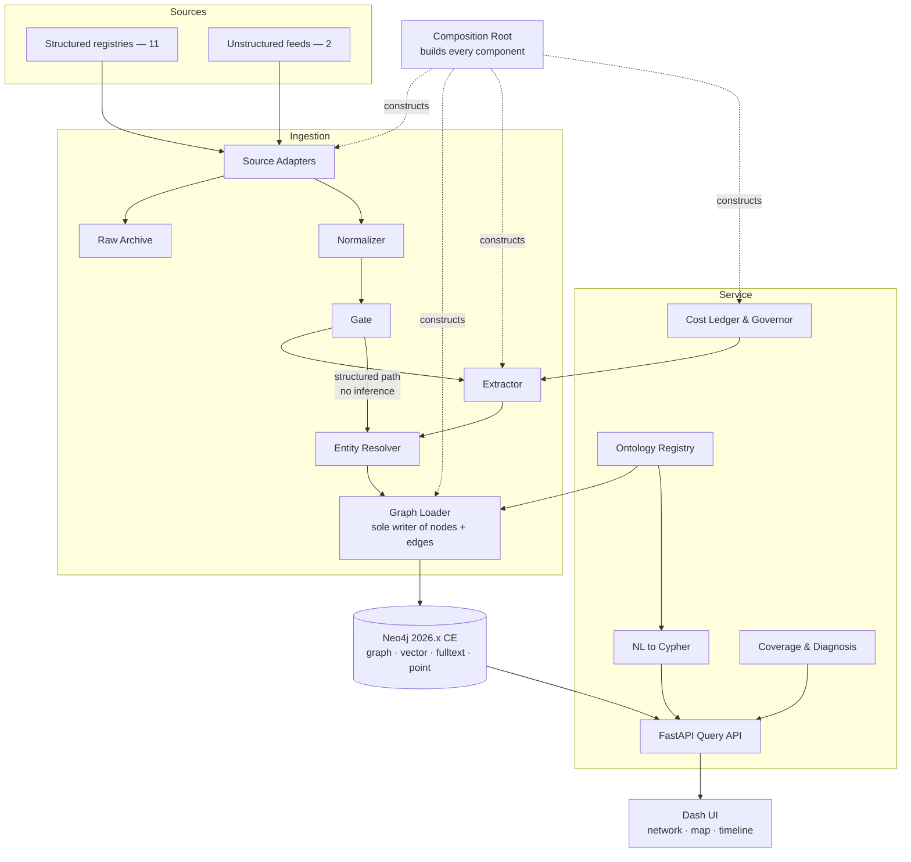

> Historical design reference. Current runtime, access, operations and deployment
> are regenerated in [ARCHITECTURE](ARCHITECTURE.md), [OPERATIONS](OPERATIONS.md)
> and [TESTING_PHASE](TESTING_PHASE.md). Unchanged graph/type/coverage contracts
> remain applicable; old runtime restrictions and backup shell flows are superseded.

> Initial implementation baseline. Changed runtime, access, configuration,
> inference and governance behavior is superseded by [TESTING_PHASE.md](TESTING_PHASE.md).
> Its remaining-work section identifies runtime requirements still pending.

<!-- LIMES — Design Document | v2.0.0 | 2026-07-28 | Status: Draft -->

# LIMES — Design Document

| Field | Value |
|---|---|
| Document | LIMES — Design Document (Document 1 of 3) |
| Version | 2.0.0 |
| Date | 2026-07-28 |
| Status | Draft |
| Ontology version | 1.0.0 |
| Supersedes | v1.0.0 (2026-07-23), withdrawn |
| Companion documents | Technical Specification v2.1.0; Desktop Client Requirements v1.0.0 and Desktop Client Architecture v1.0.0 |

## Revision History

| Version | Date | Changes |
|---|---|---|
| 1.0.0 | 2026-07-23 | Initial issue. Withdrawn — see below. |
| 2.0.0 | 2026-07-28 | Clean re-issue for a from-zero restart. The v1.x document set accumulated fifteen defects of two kinds: seams specified without a named constructor or invoker (twelve), and sections designing against constraints stated earlier in the same document set (three). Three were found by a coding agent during implementation, twelve by a call-trace audit afterward. All are resolved at source here rather than by revision. Substantive changes from v1.0.0: §7 no longer claims database-enforced read-only separation, which Neo4j Community cannot provide (C-01); §4.14 adds the composition root as a named component; §5.5 distinguishes pre-resolution from resolved assertions; §4.7 assigns node creation to the loader. |
| 2.0.0 | 2026-08-01 | Companion-document references updated for the v2.1.0 amendments (Technical Specification v2.1.0, Implementation Roadmap v2.1.0 — the §5.6 `label_embedding` merge stamp and WP-25a). No substantive change; the design decisions this document records are unaffected. |

### Why v1.x Was Withdrawn

The v1.x documents passed every internal-consistency check: complete traceability from requirement to scope item to work package, an acyclic dependency graph, a full coverage matrix, no contradictions found by cross-reference. Implementation stalled three times regardless.

The checks all had one blind spot. A specification whose modules cannot reach each other satisfies every one of them. Traceability proves the roadmap covers the specification; it proves nothing about whether the specified system runs.

This document set adds one artifact to close that: **Technical Specification §15, a seam register derived from end-to-end call traces.** Every cross-module handoff has a named constructor or invoker, and every primary runtime path is traced from entry point to committed state before the specification is delivered. The register is built from the call graph, not from the module list — building it from the module list is what produced the second round of defects after the first was fixed.

### Reversibility Tags

Design decisions in §10 carry a reversibility tag:

- **R1** — reversible within a session. Configuration, thresholds, prompts, UI arrangement.
- **R2** — reversible with a bounded migration. Schema additions, new adapters, storage layout.
- **R3** — effectively irreversible without rebuilding a substantial portion. Storage engine, core data model semantics, provenance design.

---

## 1. Overview and Goals

### 1.1 What LIMES Is

LIMES is a local, single-operator, ontology-driven knowledge graph for German and European policy and geostrategic analysis. It ingests structured registries and unstructured German- and English-language text, maps both onto a fixed ontology of real-world entities and relationships, and provides network, geographic, and temporal views over the result.

It follows the data-fusion and link-analysis paradigm, not the business-intelligence one. It does not count transactions. It records that a specific corporation was a subsidiary of a specific parent during a specific interval, according to a specific source, with a specific confidence — and lets the operator traverse outward from there.

### 1.2 Goals

| ID | Goal |
|---|---|
| G-01 | A standing analytical instrument the operator can query about German and EU policy over months, with the dataset accumulating rather than being rebuilt. |
| G-02 | Confront and solve, at proof-of-concept scale, the three engineering problems characteristic of this system class: ontology design, entity resolution, temporal provenance. |
| G-03 | Support open-ended, unanticipated exploration. The operator's questions are not known in advance and will change. |
| G-04 | Make every displayed claim traceable to its source, its extraction provenance, and where applicable the exact sentence that produced it. |
| G-05 | Operate within a hard ceiling of EUR 10 per month for paid inference at steady state. |
| G-06 | Run entirely on local Docker Compose while remaining deployable to a 12 GB host without architectural change. |
| G-07 | Serve, secondarily, as a demonstrable artifact. Explicitly lower priority; constrains no decision in this document. |

### 1.3 Success Criteria

1. The operator can pose a multi-hop question in natural language, receive executable Cypher, inspect it, run it, and receive either results or a diagnosis of which hop the data could not satisfy.
2. Every edge carries source, temporal validity, and confidence; the UI can display the originating sentence for any news-extracted assertion.
3. A model or prompt version change is a versioned, re-runnable, costed event with a measurable effect on extraction quality.
4. The graph contains all thirteen configured sources, and steady-state operation stays under the budget ceiling.

---

## 2. Requirements Summary

### 2.1 Functional Requirements

| ID | Requirement | Trace |
|---|---|---|
| FR-01 | Ingest structured data from official registries via deterministic parsers, with no paid inference. | CA |
| FR-02 | Ingest unstructured German- and English-language text and extract typed entities and relations. | OR |
| FR-03 | Map all ingested data onto a declarative, versioned ontology; reject any assertion violating it. | CA |
| FR-04 | Resolve entity mentions across sources and languages to canonical entities, non-destructively and reversibly. | OR |
| FR-05 | Record every assertion bitemporally: validity interval and belief interval, independently queryable. | CA |
| FR-06 | Record provenance on every assertion: source, confidence, extractor model, prompt version, schema version, ontology version, evidence span where derived from text. | CA |
| FR-07 | Retain contradictory assertions from different sources; expose a query-time trust ranking. | CA |
| FR-08 | Natural-language querying that generates Cypher, validates it against the ontology deterministically, plans it, then executes it read-only. | CA |
| FR-09 | A query builder generated from the ontology, offering only relations valid for the selected domain and range. No hand-authored templates. | CA |
| FR-10 | Diagnose empty result sets by decomposing the query and reporting which clause emptied it, with graph-wide counts. | CA |
| FR-11 | Attach a coverage report to every result: contributing sources, per-relation-type edge counts, per-source last-refresh timestamps. | CA |
| FR-12 | Three synchronized views over query results: network graph, map, timeline. | OR |
| FR-13 | Display the generated Cypher for every query; permit editing and re-execution. | PDD |
| FR-14 | Persist every executed query with its natural-language form, generated Cypher, ontology version, result count. | CA |
| FR-15 | Meter and ledger every paid API call; refuse calls exceeding the configured monthly ceiling. | CA |
| FR-16 | Gate paid extraction behind deterministic filters: content-hash deduplication, local NER pre-filter, passage selection. | CA |
| FR-17 | Cache extraction results keyed by content hash, prompt version, schema version, model identifier. | CA |
| FR-18 | Trigger all ingestion manually. No scheduler. | OR |
| FR-19 | Evaluate extraction quality against a hand-labeled gold set; gate version changes on non-regression. | CA |

### 2.2 Non-Functional Requirements

| ID | Requirement |
|---|---|
| NFR-01 | Total resident memory of all services must not exceed 11 GB, targeting a 12 GB host. |
| NFR-02 | Total storage footprint under 100 GB including the raw document archive. |
| NFR-03 | Steady-state paid inference under EUR 10 per calendar month. |
| NFR-04 | No component may depend on a GPU. |
| NFR-05 | All ingestion must be idempotent. Re-running over the same input must not duplicate entities or edges. |
| NFR-06 | All configuration supplied by environment variables. No host paths, no hardcoded credentials. |
| NFR-07 | UI language is English. Source text displayed verbatim in its original language. |
| NFR-08 | Deliverable documents, the ontology, and the gold set carry independent semantic version lines. |
| NFR-09 | Every specified module, function, and type has at least one specified caller or constructor. Verified by Technical Specification §15. |

### 2.3 Constraints

| ID | Constraint | Honored by |
|---|---|---|
| C-01 | Storage engine is Neo4j 2026.x Community Edition. Single database, **no role-based access control**, no online backup. | §7.2, §8.5 |
| C-02 | Paid inference routed exclusively through OpenRouter. | §4.5 |
| C-03 | Runtime is Docker Compose on a single host. No orchestrator, no cloud services. | §8.1 |
| C-04 | Backfill of unstructured sources reaches 90 days. Structured sources backfill fully. | §9.2 |
| C-05 | Local Ollama and large spaCy models are laptop-only, excluded from the portable resource contract. | §8.2 |
| C-06 | Neo4j spatial supports points, distances, bounding boxes only. No polygon operations. | §5.7 |
| C-07 | **Every CLI invocation is a fresh operating-system process.** No module-level state survives between commands. | §4.14, §5.9 |

C-01 and C-07 are the two constraints the v1.x set violated after stating them. C-01's absence of RBAC was stated in v1.0.0 §2.3 and then contradicted by a security architecture built on differentiated database privileges. C-07 was implicit and unstated, and produced a cross-process lookup that no invocation could read. Both are now stated as constraints and carry an explicit honoring section.

### 2.4 Non-Goals

| ID | Non-Goal |
|---|---|
| NG-01 | Multi-user access, authentication, authorization, session management. |
| NG-02 | Automated or scheduled ingestion. |
| NG-03 | Personal-data scoping, retention policy, pseudonymization. |
| NG-04 | Paid data sources, OpenCorporates, X/Twitter, paywalled press, satellite imagery. |
| NG-05 | Quantitative economic time series. |
| NG-06 | PostGIS or any polygon-capable spatial engine. |
| NG-07 | Production deployment, high availability, distribution of the artifact. |
| NG-08 | Hand-authored query templates. |

---

## 3. System Architecture

### 3.1 Style

Four layers with strict downward dependency, plus one composition root that sits outside the layering and constructs everything. No layer calls upward. The query API is the only path to the graph for any user-facing component.

### 3.2 Two Asymmetric Ingestion Paths

The single most important structural property.

**The structured path carries no inference cost.** Eleven of thirteen sources are deterministic parsers over official registries. They produce the highest-trust and most analytically valuable edges — ownership, sanctions, contracts, office-holding, legal citation. They cost nothing per record and cannot hallucinate.

**The unstructured path is a supplement.** It captures events and relationships no registry publishes. It is gated, cached, metered, and lower-trust. An architecture inverting this ratio is unaffordable at the stated budget and untrustworthy at any budget.

### 3.3 Container Topology

| Service | Purpose | Credentials held | Published |
|---|---|---|---|
| `neo4j` | Storage engine | — | never |
| `api` | Query service | DB credentials; OpenRouter key | internal only |
| `ui` | Dash application | none | localhost only |
| `worker` | Ingestion, CLI | DB credentials; OpenRouter key | never |

The `api` service holds the OpenRouter key and database write access. This differs from the v1.x design, which withheld both and thereby made three specified endpoints unimplementable — natural-language generation is paid inference, and query persistence and cost ledgering are writes. §7 specifies what constrains the API instead.

### 3.4 Data Flow: Structured Source

Composition root builds the run context → adapter fetches → raw payload archived under its content hash → normalizer maps records to ontology-typed assertions carrying fully-identified endpoints → loader validates against the ontology, materializes entity nodes, merges relationships bitemporally.

No paid call at any stage. Identity comes from deterministic keys computed by the adapter; no resolution is required.

### 3.5 Data Flow: Unstructured Source

Adapter fetches → document archived → normalizer extracts text, timestamp, language → gate discards documents already extracted under the current version triple, runs local spaCy NER, discards passages below the mention threshold → surviving passages batched into schema-constrained extraction calls through the budget governor → extractor returns **pre-resolution assertions carrying mentions, not identified entities** → resolver converts mentions to identified endpoints, minting new identities where none match → loader validates, materializes, merges.

The distinction between pre-resolution and resolved assertions is load-bearing and is why §5.5 defines two types. The extractor cannot assign identity; resolution is what does.

---

## 4. Component Responsibilities

### 4.1 Source Adapter
**Owns:** fetching from one source; declaring its identity, trust rank, incremental capability, backfill capability; emitting raw payloads and normalized records.
**Does not own:** entity resolution, cross-source deduplication, **any write to the graph**.

### 4.2 Raw Archive
**Owns:** durable, compressed, content-addressed storage of every fetched payload; being the system of record from which the entire graph is re-derivable.
**Does not own:** search, indexing, serving read traffic.

### 4.3 Normalizer
**Owns:** converting source records into ontology-typed assertions; language detection; timestamp normalization; text extraction from markup.
**Does not own:** judging whether an assertion is true, novel, or worth keeping.

### 4.4 Gate
**Owns:** content-hash deduplication against the extraction cache; local spaCy NER; passage selection by mention density; ensuring nothing reaches the extractor that a free filter could reject.
**Does not own:** relation extraction.

### 4.5 Extractor
**Owns:** producing typed pre-resolution assertions from passages via a schema-constrained OpenRouter call; attaching model, prompt version, schema version, confidence, evidence span; writing every call to the cost ledger.
**Does not own:** entity identity, resolution, any graph write.

### 4.6 Entity Resolver
**Owns:** converting mentions to identified endpoints. Deterministic identifiers take absolute precedence and short-circuit everything. Otherwise: embed, retrieve candidates by vector similarity, adjudicate where ambiguous, mint a new identity where nothing matches.
**Does not own:** destructive merging. No node is ever absorbed or deleted. A merge is a link; unmerging is retracting it. **The resolver mints identities but does not write entity nodes** — it returns identified endpoints and the loader materializes them, so a new entity is created in the same transaction as the assertion justifying it.

### 4.7 Graph Loader
**Owns:** validating every assertion against the ontology; **materializing canonical entity nodes**; stamping ontology version; idempotent bitemporal merge; closing superseded validity intervals; materializing reference-data lookup rows. **Sole writer of ontology-typed nodes and relationships.**
**Does not own:** resolving contradictions. Contradictory assertions from distinct sources are both written.

### 4.8 Ontology Registry
**Owns:** loading and self-validating the declarative ontology; exposing types, relations, and domain/range constraints to the loader, the Cypher validator, the builder projection, and the API.
**Does not own:** migration execution.

### 4.9 Cost Ledger and Budget Governor
**Owns:** recording tokens and cost for every paid call; enforcing the monthly ceiling by refusing further calls and queueing affected documents; maintaining separate authorized envelopes for backfill and re-extraction.
**Does not own:** prioritizing which documents are worth extracting. It refuses; it does not choose.

### 4.10 Query API
**Owns:** being the only path to the graph for user-facing components; validating all operator-supplied Cypher before execution; serving ontology metadata; assembling coverage reports; persisting executed queries.
**Does not own:** rendering, layout, presentation.

### 4.11 NL-to-Cypher Service
**Owns:** generating candidate Cypher from a question and the serialized ontology; submitting it to deterministic validation; one bounded regeneration on failure; plan-gating before execution.
**Does not own:** executing the query, or asserting the result is correct.

### 4.12 Coverage and Diagnosis Service
**Owns:** computing contributing sources, graph-wide relation counts, and source refresh timestamps for any query; decomposing empty queries to identify the clause that emptied the set.
**Does not own:** rewriting queries to produce results.

### 4.13 Dash User Interface
**Owns:** three synchronized views with shared selection state; the ontology-generated builder; natural-language input and editable Cypher console; coverage and provenance panels.
**Does not own:** **any database access.** It calls the API exclusively and holds no credentials.

A native PySide6 desktop client (`desktop/src/limes_desktop/`) is a second user-facing API consumer under the same rule: it holds no database access and no ontology literals, fetching every graph fact over the HTTP API.

### 4.14 Composition Root

**Owns:** constructing every component the system needs, in dependency order, once per process. It is the only module that instantiates a driver, a registry, an archive, a governor, an extractor, or a gate.

**Does not own:** any business logic. It builds and hands off.

This component exists because C-07 makes every CLI invocation a fresh process, and because the v1.x design specified modules and interfaces without naming who constructed them — the defect that stalled implementation three times. A single named construction site makes "who builds this" answerable by reading one file.

---

## 5. Data Model

### 5.1 Ontology Principles

The ontology is a declarative artifact under independent semantic versioning, not conventions embedded in code. It defines entity types, supertypes, identifying keys, properties, and every relation with explicit domain and range. It is loaded at startup, self-validated, and consumed by four components.

Every node and edge records the ontology version under which it was written, so a schema change leaves older data queryable and unambiguously identifiable.

### 5.2 Entity Types

Seventeen concrete types under three abstract supertypes. Supertypes make traversal expressible without enumerating subtypes.

| # | Type | Supertype (— = none) | Identifying key |
|---|---|---|---|
| 1 | `Person` | `Agent` | Wikidata QID; Bundestag ID; else resolved |
| 2 | `PublicBody` | `Agent` | Wikidata QID; TED buyer ID; else resolved |
| 3 | `Corporation` | `Agent` | LEI; German register number; else resolved |
| 4 | `PoliticalParty` | `Agent` | Wikidata QID |
| 5 | `IGO` | `Agent` | Wikidata QID |
| 6 | `InterestGroup` | `Agent` | EU Transparency Register ID |
| 7 | `Country` | `Place` | ISO 3166-1 alpha-2 |
| 8 | `AdministrativeRegion` | `Place` | NUTS code |
| 9 | `Location` | `Place` | GeoNames ID; else coordinate hash |
| 10 | `LegalAct` | `Artifact` | CELEX; Bundesgesetzblatt citation |
| 11 | `Contract` | `Artifact` | TED notice ID |
| 12 | `Document` | `Artifact` | Content hash |
| 13 | `Sanction` | `Artifact` | FSD ID plus regime |
| 14 | `Asset` | `Artifact` | OSM ID |
| 15 | `Event` | — | Source event ID plus timestamp |
| 16 | `Office` | — | Body ID plus title plus interval |
| 17 | `Topic` | — | Vocabulary plus code |

`Office` is reified rather than expressed as a property because questions of the form "who held this position when that act was adopted" require the interval to be a joinable object. This is the most consequential modeling choice in the ontology.

`Asset` criticality is a controlled attribute against the German KRITIS sector taxonomy, not a subtype hierarchy.

### 5.3 System Node Types

Not ontology entities, excluded from the type count, each with exactly one owning writer (Technical Specification §15):

`Source`, `IngestionRun`, `ExtractionCacheEntry`, `CostLedgerEntry`, `SavedQuery`, `GoldSetItem`, `PostalCode`, `Mention`, `AdvisoryLock`.

`PostalCode` exists because of C-07: the postal-code-to-NUTS correspondence is produced by one source and consumed by three others in separate processes, so it lives in the graph rather than in module state or a derived file.

### 5.4 Relation Types

Thirty relations. [COMPLEXITY JUSTIFICATION] The approved band was 24–30. The count reaches thirty because `SANCTIONED_BY` is decomposed into `TARGETS`, `IMPOSED_BY`, and `ESTABLISHED_BY` — a sanction's target, its imposing authority, and its establishing instrument are three facts with three sources and three validity intervals.

`MEMBER_OF`, `HOLDS_OFFICE`, `OFFICE_AT`, `DIRECTOR_OF`, `OWNS_STAKE_IN`, `SUBSIDIARY_OF`, `HEADQUARTERED_IN`, `LOCATED_IN`, `PART_OF_REGION`, `TARGETS`, `IMPOSED_BY`, `ESTABLISHED_BY`, `ADOPTED`, `AMENDS`, `REPEALS`, `CITES`, `APPLIES_TO`, `AWARDED_TO`, `BUYER_OF`, `SUPPLIES`, `LOBBIES_FOR`, `MET_WITH`, `PARTICIPANT_IN`, `ACTOR_IN`, `TARGET_OF`, `OCCURRED_IN`, `OPERATES`, `ABOUT_TOPIC`, `MENTIONS`, `REPRESENTS`.

Domain and range for each are specified in Technical Specification §5.4 and are authoritative in the ontology artifact.

`ACTOR_IN`, `TARGET_OF`, and `PARTICIPANT_IN` are deliberately distinct: GDELT encodes directional asymmetry, the Transparency Register encodes symmetric attendance. Collapsing them into a role property discards what makes event data useful.

### 5.5 Two Assertion Types

A single assertion type cannot span the pipeline, because extraction produces mentions and only resolution produces identity.

**Pre-resolution assertion** — what the extractor returns. Endpoints are mentions: a surface string, an inferred type, and optionally a deterministic key found in the text.

**Resolved assertion** — what the loader accepts. Endpoints are identified: a stable entity identifier, a concrete type, a label, a deterministic key where one exists, and aliases.

The converter between them is a named module owned by the resolver. In the structured path adapters produce resolved assertions directly, because deterministic keys make identity computable without inference.

### 5.6 Assertion Metadata

Every relationship, and every node property not derived from a deterministic key, carries: `assertion_id`, `valid_from`, `valid_to`, `recorded_at`, `retracted_at`, `source_id`, `source_trust`, `confidence`, `extractor_model`, `prompt_version`, `schema_version`, `ontology_version`, `evidence_document_id`, `evidence_start`, `evidence_end`.

Nothing is deleted. A sanction being lifted sets `valid_to`. An extraction error being corrected sets `retracted_at`. The two are independent, which makes both "who controlled this company in March 2025" and "what did the graph believe in March 2025" answerable. The second is how extraction quality is measured over time.

### 5.7 Bitemporal and Node Semantics

Node materialization precedes relationship merge in the same transaction. A partial batch can leave neither an edge without endpoints nor an endpoint without its justifying edge. Node merge is non-destructive: an existing label, deterministic key, and original ontology version are never overwritten, so a lower-trust source cannot degrade an entity a higher-trust source established.

Interval closure is scoped strictly to a single source. Closing across sources would destroy the disagreement between them, which in this domain is frequently the signal.

Geography is stored as points. Region membership is assigned at ingest through the postal-code correspondence, never computed from geometry — which is what keeps a polygon-capable engine out of scope (C-06, NG-06).

### 5.8 Source Trust Ranking

| Rank | Sources |
|---|---|
| 1.00 | GLEIF, EUR-Lex, EU FSD, TED, Transparency Register, Bundestag DIP, Gesetze im Internet, GISCO/NUTS |
| 0.90 | Wikidata |
| 0.75 | OpenStreetMap |
| 0.70 | Commission RAPID, Bundesregierung releases |
| 0.60 | Curated news outlets |
| 0.50 | GDELT |
| 0.30 | OffeneRegister |

OffeneRegister sits at the bottom deliberately. Its data is materially stale, and it records the dataset's own publication date as `recorded_at`, not the ingestion timestamp. With honest vintage, low trust, and reversible merges, stale data is safely representable; no free current alternative exists for German directorships.

The effective trust of an extracted assertion is the product of the document's source trust and the extraction confidence.

### 5.9 Cross-Process State

C-07 governs. Any value one command produces and another consumes lives in the graph as a system node with its own provenance and refresh timestamp — never a module global, never a derived cache file, never a re-download. The postal-code correspondence is the first instance; the rule is general.

---

## 6. API and Interface Design

### 6.1 Surface

The API is the only path to the graph. It serves operational endpoints, entity and search endpoints, three query paths, coverage, saved queries, and the cost ledger. Full specification in Technical Specification §6.

### 6.2 Natural-Language Query Contract

Four stages; the second is deterministic, and that is what makes the approach safe.

**Generate** — the complete serialized ontology, roughly 1,500 tokens, is supplied with the question. The small closed ontology is why this is tractable; this is not text-to-SQL against a large warehouse.

**Validate** — every label and relation must exist; every relation must satisfy declared domain and range; write clauses and side-effecting procedures are refused by parse-level inspection; a limit is injected if absent. On failure, exactly one regeneration with the reason supplied.

**Plan** — `EXPLAIN` runs before execution. Cartesian products and unbounded expansions are rejected with the plan shown, rather than exhausting an 11 GB envelope.

**Execute and report** — the generated Cypher is always returned and always editable. Every result carries a coverage report. Empty results trigger diagnosis automatically.

### 6.3 Empty-Result Diagnosis

An empty result is the characteristic failure of this system class, because absence of evidence reads as evidence of absence. Each `MATCH` clause is executed independently and the first that returns nothing is reported, with graph-wide counts for the relation types involved. An empty result without that report is a false statement about the world carrying the operator's name.

### 6.4 Generated Query Builder

Rendered from the ontology at runtime, not authored. Selecting a type offers only relations its domain admits, then only types their range admits, then filters from declared property types, then optionally another hop. Temporal qualifiers are offered on every temporal relation. It cannot construct an invalid query and costs nothing per use.

No query templates exist anywhere in this system (NG-08). Templates encode anticipated questions; the instrument exists for unanticipated ones.

### 6.5 UI Structure

One exploration screen, three synchronized panes over a shared selection: network with node-click expansion, map, timeline with a brush that triggers re-query rather than client-side filtering. Supporting elements: natural-language input, editable Cypher console, generated builder, coverage panel, provenance panel showing the originating sentence, saved-query list, budget indicator. A native PySide6 desktop client (`make desktop-run`) presents these same surfaces and is likewise a pure API consumer, holding no database access and no ontology literals.

### 6.6 Command Line

Ingestion is manual. `make up`, `down`, `bootstrap-db`, `ingest`, `ingest-all`, `backfill`, `reextract`, `select-models`, `evaluate`, `migrate`, `backup`, `stamp-embeddings`. `backfill` and `reextract` require an explicit budget argument and cannot draw on the steady-state envelope.

---

## 7. Security Architecture

### 7.1 Threat Model

Single operator, single host, no network exposure beyond loopback, no untrusted users. Authentication, authorization, session management, and tenant isolation are non-goals (NG-01). Four real concerns remain, none about users.

### 7.2 Read-Only Enforcement — and What C-01 Costs

**Neo4j Community Edition has no role-based access control (C-01).** Additional users can be created; their privileges cannot be restricted. There is no read-only role to grant. The v1.x design specified database-enforced privilege separation and made it an enforcement layer, which was not implementable on the chosen engine — a section designing against a constraint stated four sections earlier.

What is actually available, in order of strength:

1. **Parse-level rejection.** All operator-supplied and generated Cypher is refused if it contains a write clause, a side-effecting procedure, or an unallowlisted procedure call. Detection is by inspection of the parsed statement, not substring search. This is the primary defense and the only one that inspects intent.
2. **Driver access mode.** Query-path sessions are opened with read access mode, so the driver refuses writes client-side. Weaker than a server privilege — code in the API process can open a write session — but it is a real second barrier against a validator defect, which is the actual failure mode of concern.
3. **Enumerated write surface.** The API performs exactly three writes, all parameterized, all system nodes, none constructed from operator input: a cost ledger entry per paid call, a saved query per execution, and a saved-query create or delete. That list is complete and is an acceptance criterion — no other write path may exist in the API package.

**Residual risk, stated plainly:** a defect in the Cypher validator combined with a defect in session-mode selection can write to the graph. On Community Edition this cannot be prevented by the database. For a single-operator local system with no untrusted input path other than ingested documents, this is accepted. It is recorded here rather than concealed behind a privilege claim the engine cannot honor.

### 7.3 Untrusted Ingested Content

The most substantive security property. LIMES ingests arbitrary public text and passes it to a model that produces assertions the operator will later trust. Mitigations, layered: document text is supplied as explicitly delimited data, never concatenated into the instruction portion; extraction calls carry no tool definitions; output is schema-constrained; every assertion is validated against the ontology before it can reach the graph; every surviving assertion carries its evidence span and source, so an injected claim is traceable to the sentence that produced it and retractable without disturbing anything else.

Injection cannot be prevented at the model layer. It can be made validated, attributed, and reversible.

### 7.4 Secrets and Exposure

The OpenRouter key is supplied by environment variable, never committed, and held by the `api` and `worker` services — both make paid calls. The `ui` service holds no credentials of any kind. The Neo4j port is never published. The UI port is published to loopback only, in the local override file.

### 7.5 Personal Data

Out of scope (NG-03), by operator decision. LIMES stores named natural persons in public roles with inferred relationships between them, and implements no scoping, retention, or pseudonymization. The repository carries a disclaimer stating it is a personal research artifact, not operated as a service, not distributed. Insertion points are reserved — a person-scope predicate in the loader, a display-name indirection in the API response layer — so a later version adds rather than retrofits.

---

## 8. Infrastructure and Deployment

### 8.1 Compose Topology

One base file defining four services, one internal network, named volumes, and no published ports. One override file carrying local-only concerns: loopback publication, source mounts, debug logging. Promotion to a server is removal of the override, not a rewrite.

### 8.2 Resource Contract

Targeting the 12 GB ceiling (NFR-01), not the development machine.

| Component | Resident |
|---|---|
| Neo4j — heap 2 GB, page cache 2 GB | ~4.5 GB |
| spaCy German and English models, one worker | ~1.5 GB |
| Ingestion workers, two | ~2.0 GB |
| FastAPI and Dash | ~0.7 GB |
| OS and Docker overhead | ~1.5 GB |
| **Total** | **~10.2 GB** |

A locally hosted model useful for German relation extraction needs 6–8 GB resident and does not fit. Ollama is a laptop-only, manually invoked overflow path (C-05). Large spaCy models are likewise laptop-only.

### 8.3 Storage

Neo4j data 5–20 GB at proof-of-concept scale; the compressed content-addressed archive single-digit GB per year at curated-feed volume. Against 100 GB the retention policy is to keep everything — re-extraction under an improved prompt is a design feature and requires the original bytes.

### 8.4 Configuration

All by environment variable with a committed example enumerating every key. No host paths. Named volumes only. Pinned model identifiers, prompt and schema versions, budget ceiling, and Neo4j memory sizing are all configuration.

### 8.5 Backup

Community has no online backup (C-01). The procedure stops the database, dumps offline, restarts. Acceptable because the graph is derivable: the archive is the system of record, and rebuild costs no paid inference while the version triple is unchanged.

---

## 9. Operational Model

### 9.1 Ingestion

Manual. Every run records source, window, counts, errors, and cost. Idempotent by content-derived identity (NFR-05). The ingestion window for an incremental source is resolved from that source's last successful run; static sources load fully.

### 9.2 Backfill

Structured sources fully, at no inference cost. Unstructured sources 90 days (C-04), under an explicit budget argument that cannot draw on the steady-state envelope. This separation exists because the budget does not break on steady state — it breaks on backfill and re-extraction.

### 9.3 Cost Control

Every paid call writes a ledger entry. The governor refuses calls past the ceiling and queues affected documents rather than failing the run. Order-of-magnitude sizing is pinned by measurement, not asserted: one passage-level extraction call runs roughly 1,200 input and 350 output tokens; twenty exploratory natural-language queries per day cost on the order of USD 0.35 per month.

### 9.4 Re-extraction

A prompt, schema, or model version change invalidates nothing automatically — the cache key includes all three, so the next ingest re-extracts only new content. Deliberate re-extraction is an explicit command with a version and a budget. Superseded assertions are retracted, never deleted, so the graph records what it believed before and after.

### 9.5 Quality Gate

Two hundred hand-labeled sentences, one hundred German and one hundred English, drawn from the operator's own archive. Precision and recall measured per relation type. A model, prompt, or schema version ships only if it does not regress the gold set. The baseline is stored machine-readably; the changelog carries the human record.

This is the only mechanism preventing silent degradation. Without it, a model substitution can quietly halve recall on German extraction and the graph simply contains fewer edges, which looks identical to a quiet news week.

### 9.6 Ontology Change

Additive changes are minor bumps requiring no migration; existing data remains valid under its stamped version. Breaking changes are major bumps requiring a numbered migration that rewrites the version stamp on affected nodes and edges.

### 9.7 Monitoring

No monitoring stack. The observable surfaces are the run log, the cost ledger, per-source refresh timestamps, and the coverage figures attached to every query. For a single-operator local system these suffice.

---

## 10. Key Design Decisions

| ID | Decision | Rationale | Rejected | Rev |
|---|---|---|---|---|
| DD-01 | Neo4j 2026.x Community as sole storage engine | Graph, vectors, full text, and point geometry in one container; deepest documentation corpus, which improves coding-agent output | Memgraph (memory-first); ArangoDB (AQL forfeits Cypher priors); FalkorDB (thin ecosystem); Postgres+AGE (incomplete Cypher on the load-bearing path); Kùzu (archived Oct 2025) | R3 |
| DD-02 | Bitemporal assertions with mandatory provenance | Distinguishes what was true from what was believed; makes extraction quality measurable and corrections non-destructive | Single-timestamp model — cannot express "held office when the act was adopted" | R3 |
| DD-03 | Contradictions retained, resolved at query time | Two sources disagreeing is frequently the signal | Silent write-time resolution | R2 |
| DD-04 | Non-destructive reversible entity merges | Entity resolution is the acknowledged hard problem; a wrong merge must be undoable | Destructive absorption | R3 |
| DD-05 | Structured backbone carries no paid inference | Eleven of thirteen sources are deterministic parsers producing the highest-value edges; makes the ceiling achievable and the core graph non-hallucinable | LLM-first ingestion | R2 |
| DD-06 | Deterministic gating before every paid call | Removes 60–80% of volume at zero cost | Document-level extraction of everything | R1 |
| DD-07 | Hard budget governor with cost ledger | A defective loop would otherwise consume the annual budget overnight | Monitoring and discipline — not a control | R1 |
| DD-08 | Cache keyed by content, prompt, schema, model | Makes re-extraction explicit, scoped, and costed | Time-based invalidation | R2 |
| DD-09 | NL querying with deterministic validation, plus ontology-generated builder | The operator explores unanticipated questions; the ontology is small and closed, which is why generation is tractable | Template library at any count; unvalidated generation | R1 |
| DD-10 | Automatic empty-result diagnosis | Absence of evidence reading as evidence of absence is the characteristic failure of this system class | Returning an empty set | R1 |
| DD-11 | Mandatory coverage report on every result | Makes data limits visible at the point of use | Documenting them separately | R1 |
| DD-12 | Region membership assigned at ingest via lookup | Avoids the only geospatial operation Neo4j cannot perform, keeping a second engine out of scope | PostGIS sidecar | R2 |
| DD-13 | `Office` reified as a first-class node | Interval-joined questions are otherwise inexpressible | Office as a relationship property | R2 |
| DD-14 | FastAPI query API regardless of UI; Dash first | Makes the UI disposable and migration mechanical; Dash has a real event model, which Streamlit's script-rerun and iframe isolation cannot provide | Streamlit; direct SPA | R1 |
| DD-15 | OffeneRegister at lowest trust with honest vintage | Stale data is safely representable given provenance; no free current alternative for German directorships | Permanent exclusion | R1 |
| DD-16 | Ontology as declarative versioned artifact consumed by four components | One definition rather than four drifting copies | Conventions in code | R3 |
| DD-17 | Manual ingestion only | Operator requirement; nothing spends money without deliberate initiation | Scheduled ingestion | R1 |
| DD-18 | **Single composition root** | Every CLI invocation is a fresh process (C-07); a single named construction site makes "who builds this" answerable by reading one file. Its absence stalled the v1.x implementation three times | Per-module construction; import-time side effects | R2 |
| DD-19 | **Loader is sole writer of ontology-typed nodes and relationships** | Node identity, labeling, and key stamping in one place, transactionally bound to the assertions that justify them; a new entity cannot exist without its evidence | Adapter-side writes; resolver-side writes | R3 |
| DD-20 | **Cross-process state lives in the graph** | C-07 makes module state unreachable across commands; the graph already carries provenance and refresh timestamps for everything else | Derived cache file; re-download; config key | R2 |
| DD-21 | **API holds write credentials and the inference key, constrained by an enumerated write surface** | Query generation is paid inference and query persistence is a write; C-01 makes database-enforced separation unavailable, so the enforceable property is that the API's write surface is a fixed, checkable list | Withholding both — makes three specified endpoints unimplementable; claiming database enforcement the engine cannot provide | R2 |

---

## 11. Open Questions and Assumptions

### 11.1 Assumptions

| ID | Assumption | If wrong |
|---|---|---|
| A-01 | Point-level geography suffices; no polygon operations | A PostGIS sidecar keyed by node ID; additive |
| A-02 | Cheap-tier pricing is within an order of magnitude of §9.3 | Gating thresholds tighten |
| A-03 | The gate removes 60–80% of raw volume | Below 40%, the feed set narrows |
| A-04 | Serialized ontology stays near 1,500 tokens | Past ~4,000, generation degrades and argues for retrieval over the ontology |
| A-05 | OSM tagging is adequate for KRITIS categories in Germany | Asset coverage sparse; the coverage report makes it visible |
| A-06 | No GPU available or required | Local model paths unavailable, as already assumed |
| A-07 | Unstructured volume stays at 100–200 items/day | The governor throttles; queue depth grows |

### 11.2 Open Questions for Document 2

| ID | Question |
|---|---|
| OQ-01 | Pinned model identifiers, selected by measurement rather than assertion |
| OQ-02 | Vector-similarity thresholds separating automatic linkage, adjudication, rejection |
| OQ-03 | Extraction batching and its interaction with evidence-span attribution |
| OQ-04 | Neo4j heap and page cache tuning against the 12 GB envelope |
| OQ-05 | Gold set composition and match semantics |
| OQ-06 | Plan-gate rejection rules: which operators and thresholds |

### 11.3 Known Coverage Limitations

Properties of available data, not defects. The coverage report exists to surface them at the point of use.

1. **Supplier relationships have no structured source.** GLEIF gives ownership, TED gives buyer-to-prime-contractor; neither gives supply chains. `SUPPLIES` edges come from news extraction only — sparse, low-confidence, biased toward what was reported.
2. **Current German directorships are structurally weak.** OffeneRegister is stale, Bundesanzeiger is awkward at scale, Wikidata covers only notable executives.
3. **OpenStreetMap infrastructure coverage is uneven** in completeness and tagging discipline.

### 11.4 Deferred

Person-scope predicates and pseudonymization; scheduled ingestion; a polygon-capable spatial engine; multi-user access. Each has a reserved insertion point.
