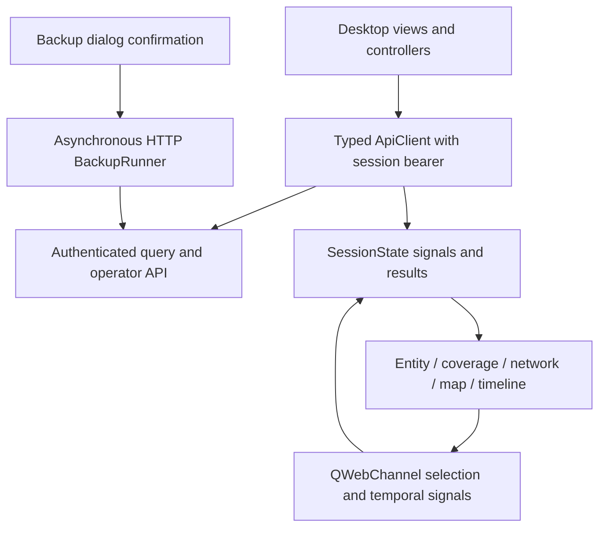

<!-- LIMES — Desktop Client Architecture | v1.0.0 | 2026-09-08 | Status: Maintained -->

# LIMES — Desktop Client Architecture

| Field | Value |
|---|---|
| Document | LIMES — Desktop Client Architecture |
| Version | 1.0.0 |
| Date | 2026-09-08; reconciled 2026-10-27 |
| Status | Maintained architecture; current evidence in DESKTOP_ROADMAP.md |
| Depends on | LIMES — Desktop Client Requirements v1.0.0 (all); LIMES — Technical Specification v2.1.0 (§6, §13.2, §15) |
| Supersedes | none (initial) |

## 1. Overview

The PySide6 desktop in `desktop/` is a strict authenticated API consumer.
Every graph fact and backup status comes through typed HTTP. SessionState carries
selection/history/results; view controllers call ApiClient and publish signals.
Qt widgets and QWebEngine pages render those results; no view opens a database or
extracts text. Credentials exist only in session memory. The complete product
includes qualified news/event investigation within these existing surfaces.



[DESKTOP_ROADMAP](DESKTOP_ROADMAP.md) distinguishes implementation, acceptance,
known defects and next work; the core specification defines shared claim/evidence
semantics. BE-43/DC-15 and BE-44/DC-16 are coordinated deliveries, not afterthoughts.

## 2. Layout and components

### 2.1 Repository layout

```
desktop/
  pyproject.toml            # limes-desktop distribution; depends on httpx, PySide6
  src/limes_desktop/
    __init__.py
    __main__.py             # entry point: --version, single-instance guard, MainWindow
    app.py                  # single-instance guard (QLocalServer, NFR-DC-070)
    config.py               # connection profiles in ~/.config/limes-desktop/
    state.py                # SessionState: Qt signals for selection/history
    backup_runner.py        # asynchronous API job orchestration (FR-DC-060..063)
    api/
      client.py             # ApiClient: httpx-based, one method per endpoint
      models.py             # mirrors src/limes/api/models.py (AC-DC-7)
      errors.py             # ApiUnreachable, ApiError with verbatim detail
    views/
      main_window.py        # shell: connection banner, docks, stacked views
      search.py             # SearchBar + results
      entity.py             # entity detail + provenance panel
      query_nl.py           # NLQ surface, editable Cypher pane
      query_builder.py      # builder from /builder/schema
      query_cypher.py       # console with history
      query_history.py      # saved-query panel (FR-DC-033)
      coverage_panel.py     # shared coverage/diagnosis panel (FR-DC-034)
      backup.py             # BackupDialog
      viz/                  # QWebEngineView wrappers
        page.py             # base page: lazy QWebEnginePage + QWebChannel (NFR-DC-071)
        network.py  map.py  timeline.py
        bridge.py           # Qt↔JS bridge
      ops/
        ingest.py  ledger.py  references.py
    resources/
      web/                  # bundled Cytoscape/Leaflet/Plotly pages (offline assets)
  tests/
    unit/                   # offline; ApiClient via respx; logic under pytest-qt
    contract/               # AC-DC-7 model parity + AC-DC-4 ontology-literal guard
    integration/            # against the API app mounted in-process (opt-in)
```

`desktop/` is added as a uv workspace member; the root `Makefile` gains
`desktop-install`, `desktop-run`, `desktop-lint` and `desktop-test` targets:
`uv sync --project desktop`; a `--version` sanity launch (or `MODE=ui` for the
real GUI); offline `ruff check desktop/src desktop/tests`; and
`pytest desktop/tests/unit desktop/tests/contract`. `mypy` is scoped to both
packages (`pyproject.toml`: `files = ["src/limes", "desktop/src/limes_desktop"]`).

### 2.2 Client layers and rules

- **ApiClient layer** (`api/client.py`): one synchronous method per endpoint of
  the API surface, on a single `httpx.Client` per connection profile. All HTTP
  goes through it — no view constructs a request. Errors are typed:
  `ApiUnreachable` for connection-level failures and `ApiError(status, detail)`
  for non-2xx responses (with the API's error body preserved verbatim), both in
  `api/errors.py`.
- **Model layer** (`api/models.py`): dataclasses mirroring the API response
  models — `EntityRef`, `EdgeRef`, `GraphResult`, `CoverageReport`,
  `Diagnosis`, `NlqOutcome`, `BuilderHop`, `BuilderSpec`, `HealthInfo`,
  `SearchHit`, `EntityDetail`, `NeighborRow`, `GraphNeighbors`, `SavedQuery`,
  `SourceInfo`, `CostEntry`, `CostLedger`, `IngestRun` — plus the composite
  `QueryOutcome` that fuses results with their coverage/diagnosis. Timestamps in response mirrors stay the strings JSON carries. ConnectionProfile uses Pydantic; response mirrors are dataclasses.
  `contract/` tests import the live `limes.api.models` and the router view
  models and assert field parity, so an API model change without a client
  update fails CI (AC-DC-7). Import direction: contract tests may import
  `limes`; the client runtime must not (it can be installed against a remote
  API without the server package).
- **SessionState**: a plain Qt object carrying current selection (entity id),
  navigation history, temporal filters (validity vs belief time), and the
  active connection profile. Views never mutate each other directly —
  everything flows through signals on SessionState (this is the desktop
  analogue of the Dash UI's callback graph).
- **Views**: Qt widgets for chrome (lists, forms, tables, provenance panel).
  The three viz views each embed a QWebEngineView loading a bundled offline
  page from `resources/web/`; a `bridge.py` QWebChannel adapter is the only
  Qt↔JS seam (push results in, selection changes out). View controllers invoke ApiClient; visualization pages never issue graph queries. Current map tiles are an explicit exception/violation under OI-11, not an accepted API-only guarantee.
- **BackupRunner**: owns an asynchronous QThread task that submits an idempotent
  backup job with the operator credential, polls status and bounded output, extracts
  the dump name and checks API health after success. Closing interrupts observation
  but does not cancel/replay the server job. Prerequisites are a reachable API and
  operator capability, never a local compose root or Docker CLI. The supervisor
  owns physical shutdown/dump/recovery, not desktop code.

### 2.3 Ontology handling

The client fetches `GET /ontology` and `GET /builder/schema` at connect time
and caches per profile. Entity and relation type names appear only as data
from these responses; no literals are hardcoded (AC-DC-4, guard test scans
`desktop/src/limes_desktop/` the way `tests/integration/test_ui.py` scans the
Dash UI). The query builder's structure — hops, domain/range constraint — is
driven entirely by the builder schema response.

## 3. Data flow

Query (any surface): user input → view → ApiClient method → response model →
SessionState publishes result + coverage report → active viz views and the
entity panel update → selection changes flow back through SessionState.

Every response's `CoverageReport` is stored on the result object and rendered
by a shared coverage widget (FR-DC-034); the hop-level diagnosis is the empty
state.

Bitemporal display: results carry both validity and belief timestamps; the
timeline view's belief-time discriminator sets a SessionState filter that all
views honor (FR-DC-043, FR-DC-042).

Backup: consequence confirmation → asynchronous operator job submission → status/output polling → health verification → dump/result banner. No shell subprocess or implicit retry.

## 4. Error handling

| Condition | Behavior |
|---|---|
| API unreachable (any view) | Banner + per-view degraded state within one refresh cycle; no traceback dialog (AC-DC-6). Auto-refreshing views pause. |
| API 4xx/5xx | API error body shown verbatim (esp. Cypher write-clause rejection and validation errors — the wording is diagnostic signal). |
| Schema mismatch | Typed as a client bug; dialog offers "copy details" and points at the contract test. |
| Backup prerequisites missing (API/operator capability) | Backup action disabled with the reason inline (FR-DC-063). |
| Backup job failure | Bounded credential-safe output/status; retain job ID; no automatic replay. |
| QWebEngine failure | View resets to a recoverable state; session state preserved. |

## 5. Testing strategy

- Unit (offline, `pytest-qt`, `desktop/tests/unit/`): SessionState signal flow,
  config/profile handling, search debounce, coverage panel, entity/query/ops
  views, viz payload shaping and Qt↔JS bridge, BackupRunner authenticated job submission, polling, output and health (HTTP mocked).
- Contract (`desktop/tests/contract/`): `test_model_parity.py` imports the live
  `limes.api.models` and the router view models and asserts field-level parity
  with `limes_desktop.api.models` (AC-DC-7); `test_no_ontology_literals.py` is
  the ontology-literal guard over `desktop/src/limes_desktop/` (AC-DC-4).
- Integration (needs the shared test Neo4j container, like the existing
  suites; `desktop/tests/integration/`): ApiClient against the real API app
  mounted in-process (FastAPI TestClient with lifespan management); the full search → entity →
  neighbors → NLQ → builder → Cypher → save/delete flow, plus the empty-result
  diagnosis case.
- AC-DC-1's live Compose walk-through and AC-DC-5's dump/`/health` acceptance
  are manual hand-off steps recorded in the implementation plan; there is no
  automated acceptance suite under `desktop/tests/`.
- No test makes real OpenRouter calls (repo invariant).

## 6. Security and privacy

All API routes including health/docs/version require a bearer token. Connection
profiles store names/URLs, never credentials; legacy compose_root is ignored.
HTTPS or loopback HTTP/SSH forwarding is required. Operator credentials authorize
backup and job status; consumer credentials cannot. No telemetry or direct graph
access. API-only networking remains NFR-DC-072; the current OSM tile fetch violates
it and DC-14 must settle the policy and install its guard. Do not advertise offline
maps or “only API network traffic” as already enforced.

## 7. Qualified evidence and coordinated evolution

ApiClient/models carry the backend's source-version, evidence, attribution,
modality, event lifecycle, assessment and time-precision contract. The entity and
provenance panels separate these from confidence and source trust; network and
timeline expose validity/recorded time, corrections, dependent reporting and gaps.
No standalone event ledger or extractor is added. BE-43/DC-15 changes backend
serialization, desktop mirrors and consumer views together; parity guards protect
field shape while semantic end-to-end checks prove the full workflow. BE-44/DC-16
adds cross-source developments without causal or misconduct inferences from timing.

Unknown speakers/times remain unknown. A report URL without archived text is
shown as a link/coverage gap, not fabricated evidence. Matching preserves unresolved
alternatives. The core design/specification owns these meanings; desktop consumes
them without a second ontology or inference engine.

Deferred: .deb packaging, multi-user accounts and ledger write UI. Existing
bearer authentication and HTTP backup are current behavior. Reference-platform,
startup latency and manual workflow acceptance remain in DESKTOP_ROADMAP.

## 8. Changelog

### v1.0.0 — 2026-09-08
- Initial architecture: PySide6 client in `desktop/` workspace member; strict
  API-consumer rule with a Qt↔JS bridge confined to the three viz views;
  backup via subprocess to `limes backup` (no duplicated backup logic);
  ontology-literal-free invariant enforced by guard test; contract tests
  pinning client models to `src/limes/api/models.py`.

### Reconciliation — 2026-10-27

Replace superseded unauthenticated/Docker-backup instructions with current API
contracts, retain known map-policy and acceptance gaps, and integrate qualified
news presentation into existing component/data-flow ownership. Version filename
is retained for existing links; package status is maintained separately.
