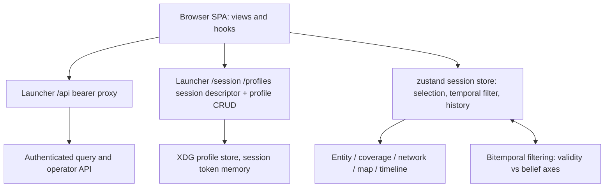

> **2026-11-12 source-scope amendment (BE-58):** All existing sources remain
> required. Acquisition/publication history starts **2020-01-01 inclusive**;
> current snapshots retain all older entities, facts and original dates.
> This is not a validity/as-of cutoff or authority to exclude a source.
> [Every-source contract and recovery policy](SOURCE_DATA_SCOPE.md) supersede
> earlier unbounded acquisition or adoption-date incremental descriptions.

<!-- LIMES — Desktop Client Architecture | v1.1.0 | 2026-09-08 | Status: Maintained -->

# LIMES — Desktop Client Architecture

| Field | Value |
|---|---|
| Document | LIMES — Desktop Client Architecture |
| Version | 1.1.0 |
| Date | 2026-09-08; reconciled 2026-10-27, 2026-11-09 (DC-17 web-client/launcher swap, D-99) |
| Status | Maintained architecture; current evidence in DESKTOP_ROADMAP.md |
| Depends on | LIMES — Desktop Client Requirements v1.1.0 (all); LIMES — Technical Specification v2.1.0 (§6, §13.2, §15) |
| Supersedes | the v1.0.0 content of this same filename (stable link identity preserved) |

## 1. Overview

The desktop (DC-17, D-99) is a browser SPA in `desktop/web/` hosted by a local
FastAPI launcher in `desktop/src/limes_desktop/` — a strict authenticated API
consumer. Every graph fact and backup status comes through typed HTTP. The
launcher serves the built bundle, proxies `/api/*` to the active connection
profile while injecting the session bearer token, and owns profile CRUD over
the XDG store. Session state (selection/history/results) lives in a zustand
store; the SPA's views read it through typed hooks. Credentials exist only in
launcher memory, never in the browser, never persisted. The complete product
includes qualified news/event investigation within these surfaces.



[DESKTOP_ROADMAP](DESKTOP_ROADMAP.md) distinguishes implementation, acceptance,
known defects and next work; the core specification defines shared claim/evidence
semantics. BE-43/DC-15 and BE-44/DC-16 are coordinated deliveries, not afterthoughts.

## 2. Layout and components

### 2.1 Repository layout

```
desktop/
  pyproject.toml            # limes-desktop launcher distribution; fastapi, httpx, pydantic
  src/limes_desktop/
    __init__.py
    __main__.py             # entry point: --version, guard, loopback uvicorn serve
    app.py                  # process-level single-instance guard (flock, NFR-DC-070)
    config.py               # connection profiles in ~/.config/limes-desktop/ (name+URL)
    webapp.py               # launcher app: SPA serve, /api bearer proxy, /profiles,
                            # /session token kinds; injectable store/http for tests
  web/                      # the SPA (pnpm + Vite + React + Tailwind v4)
    package.json            # scripts: dev/build/typecheck/vitest/eslint/gen:api
    tools/gen-api.mjs       # runs tools/export_openapi.py, then openapi-typescript
    src/
      api/                  # typed client (client.ts), mirrors (types.ts),
                            # errors (errors.ts), launcher surfaces (launcher.ts),
                            # generated contract (openapi.json, schema.ts)
      app/app-shell.tsx     # skip link, floating rail, health banner
      components/           # shared widgets incl. ReUI components + data grid
      hooks/use-connection.ts  # health poll, capabilities proof, profile mutations
      state/                # session.ts zustand store; temporal.ts filters;
                            # builder.ts DC-14 refill; payloads.ts viz shaping
      views/                # search, entity, query_nl/builder/cypher, history,
                            # viz network/map/timeline, news claims/investigations/
                            # developments/documents, ops ingest/ledger/references/
                            # offices, backup
  tests/
    unit/                   # launcher endpoints (respx), guard, CLI, profile store
    contract/               # openapi-surface parity + ontology-literal guard
    integration/            # launcher + real API app in-process (disposable graph)
```

`desktop/` is a uv workspace member; the root `Makefile` carries
`desktop-install` (canonical venv sync), `desktop-run` (`--version` default,
`MODE=ui` to serve), `desktop-test`, `desktop-integration`, `desktop-lint` and
the `web-check`/`web-install` targets over the committed pnpm toolchain.
`mypy` is scoped to both Python packages (`pyproject.toml`:
`files = ["src/limes", "desktop/src/limes_desktop"]`). CI runs the web lane on
its own runner with setup-node + pnpm.

### 2.2 Client layers and rules

- **Launcher layer** (`webapp.py`): the loopback-only FastAPI app. The
  `/api/{path}` proxy forwards exactly the decided headers, injects
  `Authorization: Bearer <session token>`, re-dispatches at most same-origin
  redirect hops (`follow_redirects=False` upstream), and refuses cross-origin
  hops with a 502 envelope while transport failures surface as the §11 503
  shape. Every upstream response body travels verbatim. `/session` reports the
  descriptor (credential kind, active profile, base URL) without secret
  material; `/session/token` classifies a submitted token by one bounded
  capabilities probe and discards nothing to disk or responses. `/profiles*` is
  the XDG store CRUD, where the profile record is name + base URL.
- **TS client layer** (`web/src/api/client.ts`): one typed method per API
  endpoint on an injectable fetch, addressing the launcher's same-origin `/api`
  paths only. Errors are typed: `ApiUnreachable` for connection-level failures
  and `ApiError(status, detail)` with the error body preserved verbatim
  (FR-DC-032) in `api/errors.ts`.
- **Generated contract** (`api/openapi.json`, `api/schema.ts`): produced by
  `tools/export_openapi.py` straight from the API's `create_app()` without a
  server run; openapi-typescript derives `schema.ts`. Contract tests recompute
  the schema and diff it against the committed files, pin the TS client's
  endpoint surface (AC-DC-7), and are pytest-only (no node required).
- **Session store** (`state/session.ts`): zustand store carrying reachability,
  health, capabilities proof, profiles, selection, temporal filter and result
  history bounded to 100 bundles. Views never mutate each other — everything
  flows through published actions (the web analogue of the Dash callback graph).
- **SPA views**: ReUI components (shadcn radix-nova style per the user style
  instruction) render chrome; Cytoscape.js/Leaflet/Plotly are bundled
  dependencies rendered directly in React components — no QWebEngine, no
  message bridge, no external tiles (D-86's conforming coordinate-only map
  policy carries into the browser).
- **Backup flow** (in the backup view): consequence confirmation dialog →
  idempotent request UUID submission → asynchronous status/output polling →
  post-success health check. Operator capability is proven through the proxy;
  prerequisites are a reachable API plus an operator credential — never a
  local compose root or Docker CLI. No automatic retry (FR-DC-060..063).

### 2.3 Ontology handling

The SPA fetches `GET /ontology` and `GET /builder/schema` at connect time and
caches per profile. Entity and relation type names appear only as data from
these responses; no literals are hardcoded (AC-DC-4 guard scans
`desktop/src/limes_desktop/` and `desktop/web/src/`). The query builder's
structure — hops, domain/range constraint, DC-14 refill semantics — is driven
entirely by the builder schema response (`state/builder.ts`).

## 3. Data flow

Query (any surface): user input → view → typed client method (through the
launcher proxy) → response payload → session store publishes result + coverage
report → active viz views and the entity panel update → selection changes flow
back through the store.

Every response's `CoverageReport` is carried on the published bundle and
rendered by a shared coverage panel (FR-DC-034); the hop-level diagnosis is
the empty state.

Bitemporal display: results carry both validity and belief timestamps; the
temporal toolbar's belief discriminator sets a store filter that all views
honor (FR-DC-043, FR-DC-042). Unknown timestamps stay unknown on their own
axis, never synthesized from the other.

Backup: consequence confirmation → idempotent operator-job submission →
status/output polling → health verification → dump/result banner. No shell
subprocess and no implicit retry.

## 4. Error handling

| Condition | Behavior |
|---|---|
| API unreachable (any view) | Banner + per-view degraded state within one refresh cycle; no traceback dialog (AC-DC-6). Auto-refreshing views pause. |
| API 4xx/5xx | API error body shown verbatim (esp. Cypher write-clause rejection and validation errors — the wording is diagnostic signal). Launcher envelopes (`NO_ACTIVE_PROFILE`, `API_UNREACHABLE`, `REDIRECT_BLOCKED`) surface the condition they name. |
| Schema mismatch | Typed as a client bug; the contract test's message names the regeneration command. |
| Backup prerequisites missing (API/operator capability) | Backup action disabled with the reason inline (FR-DC-063). |
| Backup job failure | Bounded credential-safe output/status; retain job ID; no automatic replay. |
| Cross-origin redirect | The proxy refuses it with a bounded envelope; the client shows the verbatim refusal. |

## 5. Testing strategy

- Unit (offline, `desktop/tests/unit/`): launcher endpoints via injected
  transports through respx (verbatim bodies, credential stripping, redirect
  branches, envelopes), the flock guard (in-process + separate-process
  holdouts), CLI behaviors, and the profile store/URL constraint seam.
- Contract (`desktop/tests/contract/`): `test_openapi_surface.py` recomputes
  the OpenAPI schema, requires the committed `openapi.json`/`schema.ts` to
  match it, and pins the TS client surface (AC-DC-7);
  `test_no_ontology_literals.py` scans both Python launcher sources (AST) and
  web client sources (string tokenizer) for ontology literals (AC-DC-4).
- Integration (needs the shared test Neo4j container, like the existing
  suites; `desktop/tests/integration/`): the launcher hosting the real API
  app in-process; the full search → entity → neighbors → NLQ → builder →
  Cypher → save/delete flow with launcher-side credential injection, plus the
  empty-result diagnosis case and the SPA index fallback.
- Web (`desktop/web/` vitest): pure-module pins for builder refill semantics,
  temporal filtering, and viz payload shaping; the SPA tree typechecks and
  lints and builds as its own lane.
- AC-DC-1's live Compose walk-through and AC-DC-5's dump/`/health` acceptance
  are manual hand-off steps recorded in the implementation plan; there is no
  automated acceptance suite under `desktop/tests/`.
- No test makes real OpenRouter calls (repo invariant).

## 6. Security and privacy

All API routes including health/docs/version require a bearer token; the
launcher injects it into `/api/*` — the browser holds no credential state at
any point. Connection profiles store names/URLs, never credentials. The
launcher binds loopback only. HTTPS or loopback HTTP/SSH forwarding is
required for remote APIs (profile-side URL constraint). Operator credentials
authorize backup and job status; consumer credentials cannot. No telemetry.
API-only networking remains NFR-DC-072: the SPA serves its fonts and viz
libraries from the launcher origin itself, no tile/basemap provider is
registered (the D-86 conforming coordinate-only map policy carries into the
browser), and the proxy's redirect policy keeps every hop inside the
configured origin.

## 7. Qualified evidence and coordinated evolution

The generated contract carries the backend's source-version, evidence,
attribution, modality, event lifecycle, assessment and time-precision fields.
The entity and provenance panels separate these from confidence and source
trust; network and timeline expose validity/recorded time, corrections,
dependent reporting and gaps. No standalone event ledger or extractor is
added. BE-43/DC-15 changes backend serialization and consumer views together;
the generated-schema parity guard protects field shape while semantic
end-to-end checks prove the full workflow. BE-44/DC-16 adds cross-source
developments without causal or misconduct inferences from timing.

Unknown speakers/times remain unknown. A report URL without archived text is
shown as a link/coverage gap, not fabricated evidence. Matching preserves
unresolved alternatives. The core design/specification owns these meanings;
desktop consumes them without a second ontology or inference engine.

Deferred: .deb/packaged-bundle distribution, multi-user accounts and ledger
write UI. Existing bearer authentication and HTTP backup are current behavior.
Reference-platform (launcher + browser), startup latency and manual workflow
acceptance remain in DESKTOP_ROADMAP.

## 8. Changelog

### v1.1.0 — 2026-11-09 (DC-17 / D-99)
- The PySide6/QWebEngine client is retired for a React SPA (`desktop/web/`)
  served by a FastAPI launcher (`limes_desktop.webapp`) that owns static
  serving, the `/api` bearer proxy with bounded same-origin redirect
  following, XDG profiles (name+URL) and process-level single-instance guard.
- The API contract is generated from the live OpenAPI schema
  (`tools/export_openapi.py` → `openapi.json`/`schema.ts`); the parity guard
  is pytest-only; the ontology-literal guard extends to web sources.
- Cytoscape/Leaflet/Plotly render inside the SPA with the launcher origin as
  the only asset source; D-86's no-tile policy is preserved. Backup UX rules
  move wholly into the SPA view.
- pytest-qt, respx-in-Qt, QLocalServer guards and the vendored QWebEngine
  pages are removed with the retired stack; qualification obligations of the
  retired stack stay recorded in DESKTOP_QUALIFICATION.

### v1.0.0 — 2026-09-08
- Initial architecture: PySide6 client in `desktop/` workspace member; strict
  API-consumer rule with a Qt↔JS bridge confined to the three viz views;
  backup via subprocess to `limes backup` (no duplicated backup logic);
  ontology-literal-free invariant enforced by guard test; contract tests
  pinning client models to `src/limes/api/models.py`.

### Reconciliation — 2026-10-27

Replace superseded unauthenticated/Docker-backup instructions with current API
contracts, retain known map-policy and acceptance gaps, and integrate qualified
news presentation into existing component/data-flow ownership. Version filename
is retained for existing links; package status is maintained separately.
