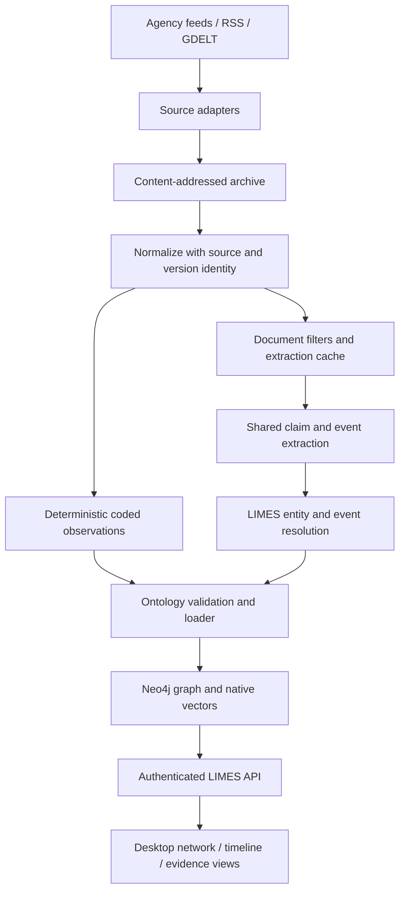

# Integrated news intelligence — target architecture

Status: accepted direction, implementation pending (D-78, 2026-10-27).
[ARCHITECTURE](ARCHITECTURE.md) describes the shipped runtime;
[ROADMAP](ROADMAP.md) defines implementation prerequisites and acceptance;
[NEWS_REVIEW](NEWS_REVIEW.md) records the external review's disposition and evidence.
This document extends the historical design/specification for planned news work;
it does not claim that the target schema or workflows already exist.

## Purpose and ownership

Agency dispatches, curated RSS/Atom entries and GDELT observations enrich the same
ontology-driven research graph as official registries. They support investigation
of developments around known entities, including proposals, announcements,
denials, agreements and later official confirmations. Temporal proximity suggests
research questions; it cannot establish causality, misconduct or coordination.

The extractor is a LIMES worker capability. Source-specific adapters acquire and
normalize records; shared extraction produces mentions and evidence; LIMES
resolution owns canonical identities; ontology validation and the graph loader own
persistence. Adapters never write directly to Neo4j. Construction stays in the
composition root, with the existing API startup exception. There is no standalone
extractor/utility, independent event-ledger application, second ontology, separate
vector database or additional service. Neo4j's existing vector index remains for
entity candidates; it is not evidence that news retrieval quality is solved.

Both normalized channels must be handled explicitly. Current `NormalizedRecord`
permits assertions and a document, but routing is exclusive; this is an open
defect, not the target mixed-record contract. Select a versioned representation
in WP-NEWS-INGEST: either explicit independent payload processing or linked
records. Deterministic output must survive document cache hits, gate rejection
and empty extraction. Define per-channel checkpoints, retry/idempotency, rejection
counters and reextract ownership so a failed document cannot erase or suppress
successfully loaded coded evidence.

## Source and evidence contract

| Record | Required target semantics |
|---|---|
| Dispatch/document | Provider and external identifier, canonical URL, language, title/body, publication/update times with unknown/fallback markers, immutable content hash and version/correction lineage |
| Evidence | Archived version plus exact text span; for coded records, export hash and row/event locator instead of invented prose offsets |
| GDELT observation | Namespaced source event identity, coding origin, complete export field mapping, event date, DATEADDED, report URL and optional Mentions associations |
| Extracted claim | Unresolved mentions, ontology relation, evidence, attribution and claim qualifiers; no model-assigned permanent LIMES IDs |
| Resolved assertion | Canonical endpoints, source/evidence links, versioned extraction and ontology provenance, validity and recorded time, qualified claim semantics |

One dispatch/version stays an identifiable document, may support many claims and
may discuss several events. Multiple documents can support one event; corrections
do not overwrite the archived original. Retain syndication/original-agency lineage
so copied reports do not count as independent corroboration. Document publication,
retrieval, event occurrence and assertion `recorded_at` are separate times; an
unknown occurrence date must not become an exact publication/fetch timestamp.

GDELT's Event export is machine-coded secondary observation, not agency prose or
proof of the underlying event. Its SOURCEURL is a link to a report, not archived
article content; its Mentions table can add report associations. Do not feed joined
actor/code summaries to extraction as though they were original reporting. Fetch
article bodies only through an explicit adapter acquisition policy with source
access, content limits and archive behavior; absent text remains a visible gap.
Retain both export-level and report-level lineage. Licensed dispatch access,
retention and display rights must be settled for the chosen provider before use.

## Claims, events and uncertainty

Extend the existing assertion mechanism rather than adding a competing assertion
store. The following are semantic requirements; exact field names/enums and
graph representation are selected against the annotated corpus in WP-NEWS-EXTRACT.

| Dimension | Examples and constraints |
|---|---|
| Statement kind | Reported observation, attributed claim, announcement, denial; retain the proposition being attributed or denied |
| Modality | Actual, proposed, planned, conditional; a proposal cannot materialize the proposed completed relationship |
| Attribution | Agency/report author versus speaker/organization versus unnamed source; retain quote/evidence and unknown identity |
| Assessment | Unassessed, supported, disputed; derived assessment records evidence and rule/version, not model certainty as truth |
| Event lifecycle/type | Proposal, negotiation, agreement, completion, cancellation; distinguish a lifecycle transition from a different event |
| Temporal precision | Exact instant, day, approximate interval, unknown; preserve precision independently of bitemporal validity |

Extraction confidence measures fidelity to text, source trust describes origin,
and corroboration describes evidence assessment. They are independent. A faithfully
extracted denial may have high extraction confidence without establishing either
the denied proposition or its negation. An announcement's occurrence and its
proposed outcome are different propositions. Do not stamp GDELT parse confidence
1.0 as factual certainty.

The current Event has only `label`, `source_event_id`, `occurred_at`; current
extraction/Assertion types lack these qualifiers. Until schema, migration and
consumers support them, preserve the prompt's prohibition on treating reported
speech as fact. Prompt relaxation alone is unsafe. Version the ontology, extraction
schema/prompt, cache keys, resolver/loader serialization and API/desktop mirrors
together. Existing assertions retain their original meaning and provenance;
unsupported historical qualifiers remain unknown. Corrected or disputed claims
coexist with prior claims under existing bitemporal/retraction semantics.

Entity resolution reuses registry keys and existing candidate/adjudication stages.
Event resolution additionally needs source namespace, actors/roles, type, time
precision and location; label/date similarity alone cannot merge events. Preserve
unresolved candidates and non-destructive decisions with evidence. A GDELT source
ID and a dispatch ID are not global event identities.

## Analyst and operational behavior

Queries and desktop views must expose reported versus documented developments,
speaker/source attribution, proposed versus completed status, evidence versions,
disputes, unknown time precision and source coverage. Compare news observations
with registry/award records without silently upgrading an attributed claim to
fact. Timeline and network views must offer validity-time and recorded-time
interpretations and links back to the supporting dispatch or coded row.

Acquisition, filtering and extraction run inside existing bounded operator jobs.
Initially an external timer may submit authenticated HTTP jobs; it does not host
extraction or add a scheduler service. The timer must observe job status and reuse
request UUIDs after uncertain responses, avoid overlapping source windows, and
never replay failed paid work automatically. Source checkpoints and bounded work
controls must be implemented before unattended news ingestion is advertised.

Cheap language/topic filters, duplicate detection and prioritization precede LLM
calls. Planned explicit document/byte/window limits must expose deferred work and
reasons, with usage and latency accounting. These are future workload controls,
not the retired monetary budget governor. Today legacy `--budget` flags are
ignored and the queue timeout alone does not cap provider spend.

Use representative DE/EN dispatches and independently annotated expectations to
measure entity/event/claim extraction, attribution, modality, evidence fidelity,
corrections, syndication and false event merges. Compare value beyond existing
feeds/GDELT on overlapping coverage. Keep quality separate from assessment of
truth and source trust. Tests use mocked paid transports; paid corpus evaluation
and production acquisition remain explicit operator runs. Implementation must
prove the full source-to-analyst path in a disposable graph before feature claims.
