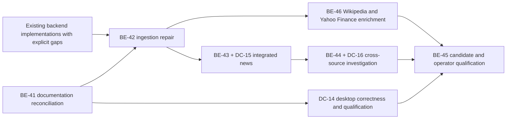

# LIMES delivery roadmap

This is the coordination index. There are exactly two authoritative package
sequences: [backend BE-](BACKEND_ROADMAP.md) and [desktop DC-](DESKTOP_ROADMAP.md).
The [documentation index](INDEX.md) identifies each document's authority; the
[baseline audit](BASELINE_AUDIT.md) records history and evidence limitations.
Historical bare WP numbers must be qualified as backend or desktop. Old counts,
unticked archived plans and merged commits are never substituted for acceptance.

## Active runtime delivery — BE-44 + DC-16 (2026-10-29)

Branch `codex/be-44-temporal-investigation`; live-main baseline `84c832df3cd5`
(PR #10). Prerequisites satisfied: BE-43/DC-15 merged, typed claims and
archive/version lineage exist; cross-source overlap is exercised on a disposable
fixture graph. Provider selection/evaluation acquisition belongs to implementation
(D-82), never an operator-supplied procurement/corpus gate. The user subsequently
requested PR publication after local acceptance; no production data run is requested.

Acceptance checklist (one complete paired parent):

- [x] Bounded investigation queries combine claims, coded observations and
  source-stamped assertions with validity and recorded-time filters and coverage/gaps.
- [x] Event candidates remain unresolved hypotheses; explicit operator reviews
  preserve alternatives, rationale and append-only recorded-time history without
  merging identities or rewriting source claims. Dependent reporting stays visible.
- [x] Proposal → denial → agreement → later official/registry evidence survives
  graph/API round trip, contradiction/history filtering and replay.
- [x] Paired desktop network/timeline/evidence navigation and temporal filters
  distinguish claims from factual edges, unknown precision and source dependence;
  API failures and late replies cannot show stale evidence as current results.
- [x] Affected/shared checks plus one authoritative full candidate run; record
  exact evidence, validation measurements and remaining external qualifications.

Local implementation acceptance passes for the complete BE-44/DC-16 parent.
`news/developments.py` and news routes deliver bounded cross-source temporal reads,
coverage and explicit event-match reviews. `views/developments.py`, API mirrors
and the investigation tabs deliver network/map/timeline and evidence navigation.
The disposable scenario proves proposal/denial/agreement/official-award and coded
evidence coexistence, historical filters, review replay/history and unchanged
factual edges. Container acceptance proves the API archive mount is read-only.
All five final suites plus lint/type/docs/whitespace checks pass at the exact
source fingerprint in VERIFICATION. The user subsequently requested preparing
and opening a PR, authorizing staging, commit and push. Production operations
remain outside this delivery. BE-45 retains live,
manual/platform, paid quality, resource/recovery and hosted-status qualification.

## Previous runtime delivery — BE-43 + DC-15 (2026-10-28)

Branch `codex/be-43-dynamic-news`, live-fetched main `b1afc86ab283`.
The user confirmed: tracked means an entity or relation belongs to an ongoing
investigation that LIMES actively keeps informed about. LIMES discovers, sets up
and acquires relevant feeds dynamically, adapting to tracked entities/relations.
Provider setup and evolving evaluation material are implementation responsibilities;
a supplied agency subscription or pre-existing corpus is not a coding prerequisite.
BE-42 is merged. No publication, production ingestion or paid run is requested.

Acceptance checklist (one integrated parent including DC-15):

- [x] Persistent investigation entity/relation tracking, pause/resume, dynamic
  identity/alias-based DE/EN feed discovery and automatic bounded worker acquisition.
- [x] Archive-linked dispatch/version/correction/syndication lineage, honest
  publication/text availability and per-investigation checkpoints; visible partial
  failures, manual failed-job replay, bounded jobs and rate/backoff behavior.
- [x] Typed attribution, modality, assessment, event lifecycle and time precision;
  qualified source→extraction→resolution→graph→API round trips with contradictions
  preserved, no unqualified denial/proposal edges or implicit event merging.
- [x] Versioned schema/prompt/cache contracts and additive migration with old
  qualifiers unknown; filtering and explicit work limits across consumers.
- [x] Desktop investigation controls and qualified evidence display, uncertainty,
  source/evidence inspection and paired analyst-facing regression acceptance.
- [x] Independently annotated DE/EN behavioral fixtures, evolving evaluation capture,
  disposable graph/API evidence and one full pre-merge candidate check.

Local implementation acceptance passes for the complete BE-43/DC-15 parent.
TrackingStore/NewsAdapter/worker cover the tracking and acquisition obligations;
the shared schema/resolver/loader and disposable graph/API scenario cover qualified
claims, preserved versions and replacement ownership. NewsView, shell relation
selection, API mirrors and timeline tests cover DC-15. VERIFICATION records the
exact candidate, final suites, source-format inspection and evidence boundaries.
The user subsequently requested preparing and opening a PR, authorizing commit
and push of this candidate. No deployment, production ingestion or paid evaluation
was requested or performed. Public RSS supplies headlines and
snippets: full article text and original-agency correction metadata remain explicit
unknowns where the source does not supply them. This is not paid-model quality,
licensed full-text coverage or production qualification.

## Historical runtime delivery — BE-42 (2026-10-28)

Branch `codex/be-42-ingestion-repair`, live main `b093599d3667`; clean
fast-forward reconciled before implementation. BE-41 and BE-46 planning are
merged. Prerequisites: upstream export pinned by NEWS_REVIEW (SHA-256 verified),
official 61-column codebook, GeoNames FIPS/ISO crosswalk, and the channel decision
below. No agency access, production data or paid calls are needed.

Acceptance checklist:

- [x] Official ZIP/61-column TSV transport, filename and bounded parsing.
- [x] FIPS conversion, all documented geography types and fractional slot ceiling.
- [x] Export hash/member/row/event/report/DATEADDED evidence persists to graph/API;
  SQLDATE remains event time, missing article text is visible.
- [x] Structured and document output load independently across gate/cache/empty
  extraction, partial failure and retry; checkpoint/reextract ownership prevents loss.
- [x] Independent upstream fixture and disposable pipeline/graph scenario plus
  affected/shared checks and full candidate verification; direct OI-19..22 evidence.

Channel decision: a normalized record may contain both structured payload and a
real document. Process structured content first, then document independently;
GDELT exports supply coded observations only, never synthetic article text.
Keep report links and a missing-text marker. Mentions ingestion is not required
for this repair: only the export's SOURCEURL association is claimed; full mention
coverage and article acquisition remain explicit gaps for BE-43. Cache entries
belong only to document extraction. Coded evidence gets its own row-scoped identity;
reextract touches extracted assertions only after successful replacement load.
No checkpoint advances after record errors or beyond the fetched window.

BE-42 implementation and local acceptance pass; the user requested PR publication after verification;
merge remains pending. Direct closure evidence and full candidate results are recorded in
VERIFICATION and OPEN_ISSUES. No production ingestion, paid calls, deployment or
hosted required-status qualification is claimed. BE-43 is next in the numbered
backend sequence, now active under the confirmed dynamic tracking contract;
BE-46 can follow BE-42 independently at its documented prerequisites.

## Current documentation delivery — BE-46 planning (2026-10-28)

Selected scope: document Wikipedia entity context and Yahoo Finance company,
governance, shareholder structure and earnings/report metadata. PR branch `codex/entity-enrichment-design`;
base `b9d940a`, verified by the live-fetch baseline checker before publication.
The user subsequently requested a PR for this documentation delivery; runtime
implementation remains unstarted. Prerequisites are the user's approved scope/provider,
current source inspection and existing architecture/package contracts.

Documentation acceptance:

- [x] Preserve German and European policy scope; defer comprehensive EU-27 coverage.
- [x] Integrate both adapters and shareholder semantics into core design and
  technical specification, including identity, provenance, persistence and API.
- [x] Define BE-46 dependencies, prerequisites and full implementation acceptance;
  mark both adapters planned, with source availability and completeness limits.
- [x] Keep generated runtime architecture, overview and document navigation aligned;
  record D-80 and validate documentation links, generation and existing guards.

This is the requested planning/documentation step, not BE-46 implementation
acceptance. The full BE-46 implementation checklist remains unchecked in the backend
register. BE-41 was merged in PR #7; BE-42 was the next runtime repair at this
planning handoff and is now verified in the active delivery above.

## Historical delivery: BE-41 — repository specification and status reconciliation

Selected 2026-10-27 on `codex/core-news-design`, based on live main `3f1effd`.
This supersedes WP-CORE-DESIGN and the earlier documentation-only framing.
Scope: reconcile backend and desktop definitions/status/evidence, core design and
technical specifications, desktop architecture/requirements, both roadmaps,
README, issue disposition and document navigation. Runtime coding is paused.
Prerequisites: recovered original roadmap, current code/history, existing evidence
and open issues; no production access or paid calls.

Acceptance checklist:

- [x] One authoritative backend sequence and one desktop sequence; original IDs
  mapped unambiguously without erasing history.
- [x] Every historical package has scope, implementation/merge evidence, acceptance
  status, current obligations and next action; unknowns explicitly bounded.
- [x] Current architecture/configuration/security/backup facts agree throughout;
  integrated news belongs in core design/specification at its actual dependencies.
- [x] README describes the complete intended product; runtime status lives in
  roadmaps/testing/operations, with no unsupported completion claims.
- [x] All known issues have an owner/package/disposition and precise closure gate;
  operator decisions and evidence gaps are retained, not inferred closed.
- [x] Superseded plans are clearly archived; links, generation, specification and
  evidence checks pass; document-only handoff names remaining implementation work.

## Current position and next work

| Track | Implemented history | Current position | Next runtime delivery |
|---|---|---|---|
| Backend | BE-01–40 plus BE-25a have implementation commits in main; changes/defects/qualification differ per row | BE-43/DC-15 merged; BE-44/DC-16 local implementation acceptance passes; no production claim | BE-45 qualification and independently available BE-46 enrichment |
| Desktop | DC-01–13 and DC-15 merged; later auth/backup/lifecycle changes supersede old behavior | DC-16 candidate paired with BE-44; OI-05/10/11/18 and manual/performance evidence remain | DC-14 correctness/qualification; BE-45 reference-platform qualification |

No further runtime coding begins before BE-41's documentation acceptance passes.
BE-42 does not wait for unrelated desktop polish or production evidence. BE-43
and DC-15 form one integrated parent delivery; BE-44 and DC-16 form the subsequent
cross-source parent. Both track entries carry the paired acceptance obligations,
so a backend-only child cannot be called a completed integrated feature.

Map-policy decisions remain named blockers in the desktop package,
not reasons to pretend earlier packages were accepted or defer news to an
unspecified after-project phase. Release evidence BE-45 can be collected for a
specific candidate earlier; it is not a prerequisite to starting BE-42.

BE-46 adds both enrichment adapters and the supporting company/shareholder model
as defined in the backend register. It can follow BE-42 independently of agency
access and BE-43/44, with schema compatibility reconciled against whichever lands
first. BE-45 qualifies the selected release candidate, including BE-46 if present.

## Review and handoff rules

One full selected parent per session/branch/PR, with checklist and actual
prerequisites before coding. Preserve incomplete obligations and concrete blockers
across interruption/compaction. Handoff maps behavior to acceptance and names
unmeasured evidence. Shared invariants use shared coverage; distinct tests need a
reason. After the first three subsequent delivery PRs compare implementation,
validation and merge latency separately and investigate CI growth/copying/repeated
corrections immediately. Do not fix process problems by shrinking packages.

Implementation, candidate verification, live/model measurement and production
release are separate claims. OPEN_ISSUES contains immutable history plus a current
status index; the two roadmaps own package placement, not duplicate issue closure.

## BE-41 handoff — documentation acceptance satisfied for PR review

All six checklist items above are satisfied: the BE/DC registers map every
historical ID and acceptance boundary; BASELINE_AUDIT and archived definitions
support the implementation evidence; core/desktop specifications and README are
reconciled; OPEN_ISSUES current index assigns every issue; C1–C9, regeneration,
links, archive preservation and focused guard validation pass (VERIFICATION.md).
The only code edits are the documentation renderer/checker and two regression
tests for documentation integrity. Runtime, fixtures, ontology and containers are
unchanged. Changes are prepared for PR publication; no new implementation was started.

No documentation blocker remains. BE-42 repairs OI-19..22; DC-14 retains its
semantic/map-policy/manual qualification obligations. Provider/corpus selection,
measured-model and production/review evidence are still explicit future blockers,
not hidden partial children of this completed documentation package. Current
root-unit and desktop-unit results do not certify them or the entire product.

## Three-delivery workflow review — 2026-10-29

The first three full packages after the delivery contract are BE-41 (PR #7),
BE-42 (PR #9) and BE-43/DC-15 (PR #10). PR #8 was the separately requested BE-46
planning delivery, not a partial runtime implementation. Their tracked checklists
and verification records retain full parent scope and named external boundaries;
BE-43 includes its paired desktop obligation rather than a backend-only handoff.

Comparable local validation durations in VERIFICATION: BE-42 root units 136.33s
and graph integration 273.75s; BE-43 root units 134.45s and graph integration
277.20s. These observations show no sustained suite-time growth over that pair;
BE-41's documentation checks have a different scope. Implementation effort and
PR/merge waiting were not measured independently, so no implementation/merge
latency comparison is claimed. Hosted required-status evidence remains OI-23.

BE-44 remains one full parent including DC-16. Its fixture-isolation and API
archive-mount corrections were addressed within the package with direct regression
checks and a newly frozen final candidate, rather than smaller delivery packages.
Shared invariant coverage remains in the existing contracts, and new tests target
distinct failure or behavior boundaries. Continue recording exact source/suite
results and separate implementation, validation and merge measurements when
available; do not invent elapsed engineering effort from test durations.
