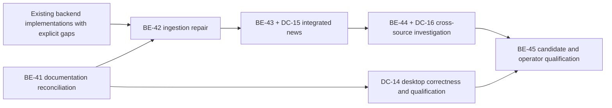

# LIMES delivery roadmap

This is the coordination index. There are exactly two authoritative package
sequences: [backend BE-](BACKEND_ROADMAP.md) and [desktop DC-](DESKTOP_ROADMAP.md).
The [documentation index](INDEX.md) identifies each document's authority; the
[baseline audit](BASELINE_AUDIT.md) records history and evidence limitations.
Historical bare WP numbers must be qualified as backend or desktop. Old counts,
unticked archived plans and merged commits are never substituted for acceptance.

## Active delivery: BE-41 — repository specification and status reconciliation

Selected 2026-10-27 on `codex/core-news-design`, based on live main `3f1effd`.
This supersedes WP-CORE-DESIGN and the earlier documentation-only framing.
Scope: reconcile backend and desktop definitions/status/evidence, core design and
technical specifications, desktop architecture/requirements, both roadmaps,
README, issue disposition and document navigation. Runtime coding is paused.
Prerequisites: recovered original roadmap, current code/history, existing evidence
and open issues; no production access or paid calls.

Acceptance checklist:

- [x] One authoritative backend sequence and one desktop sequence; original IDs
  mapped unambiguously without erasing history.
- [x] Every historical package has scope, implementation/merge evidence, acceptance
  status, current obligations and next action; unknowns explicitly bounded.
- [x] Current architecture/configuration/security/backup facts agree throughout;
  integrated news belongs in core design/specification at its actual dependencies.
- [x] README describes the complete intended product; runtime status lives in
  roadmaps/testing/operations, with no unsupported completion claims.
- [x] All known issues have an owner/package/disposition and precise closure gate;
  operator decisions and evidence gaps are retained, not inferred closed.
- [x] Superseded plans are clearly archived; links, generation, specification and
  evidence checks pass; document-only handoff names remaining implementation work.

## Current position and next work

| Track | Implemented history | Current position | Next runtime delivery |
|---|---|---|---|
| Backend | BE-01–40 plus BE-25a have implementation commits in main; changes/defects/qualification differ per row | BE-41 documentation acceptance passed; PR candidate prepared; merge pending; no all-packages-complete claim | BE-42 repairs GDELT/mixed evidence, then BE-43 agency/qualified claims |
| Desktop | DC-01–13 merged; later auth/backup/lifecycle changes supersede old behavior | Acceptance gaps OI-05/10/11/18 and manual/performance evidence remain | DC-14 correctness/qualification; DC-15 qualified evidence with BE-43 |

No further runtime coding begins before BE-41's documentation acceptance passes.
BE-42 does not wait for unrelated desktop polish or production evidence. BE-43
and DC-15 form one integrated parent delivery; BE-44 and DC-16 form the subsequent
cross-source parent. Both track entries carry the paired acceptance obligations,
so a backend-only child cannot be called a completed integrated feature.

Provider/corpus and map-policy decisions are named blockers in their own packages,
not reasons to pretend earlier packages were accepted or defer news to an
unspecified after-project phase. Release evidence BE-45 can be collected for a
specific candidate earlier; it is not a prerequisite to starting BE-42.

## Review and handoff rules

One full selected parent per session/branch/PR, with checklist and actual
prerequisites before coding. Preserve incomplete obligations and concrete blockers
across interruption/compaction. Handoff maps behavior to acceptance and names
unmeasured evidence. Shared invariants use shared coverage; distinct tests need a
reason. After the first three subsequent delivery PRs compare implementation,
validation and merge latency separately and investigate CI growth/copying/repeated
corrections immediately. Do not fix process problems by shrinking packages.

Implementation, candidate verification, live/model measurement and production
release are separate claims. OPEN_ISSUES contains immutable history plus a current
status index; the two roadmaps own package placement, not duplicate issue closure.

## BE-41 handoff — documentation acceptance satisfied for PR review

All six checklist items above are satisfied: the BE/DC registers map every
historical ID and acceptance boundary; BASELINE_AUDIT and archived definitions
support the implementation evidence; core/desktop specifications and README are
reconciled; OPEN_ISSUES current index assigns every issue; C1–C9, regeneration,
links, archive preservation and focused guard validation pass (VERIFICATION.md).
The only code edits are the documentation renderer/checker and two regression
tests for documentation integrity. Runtime, fixtures, ontology and containers are
unchanged. Changes are prepared for PR publication; no new implementation was started.

No documentation blocker remains. BE-42 repairs OI-19..22; DC-14 retains its
semantic/map-policy/manual qualification obligations. Provider/corpus selection,
measured-model and production/review evidence are still explicit future blockers,
not hidden partial children of this completed documentation package. Current
root-unit and desktop-unit results do not certify them or the entire product.
