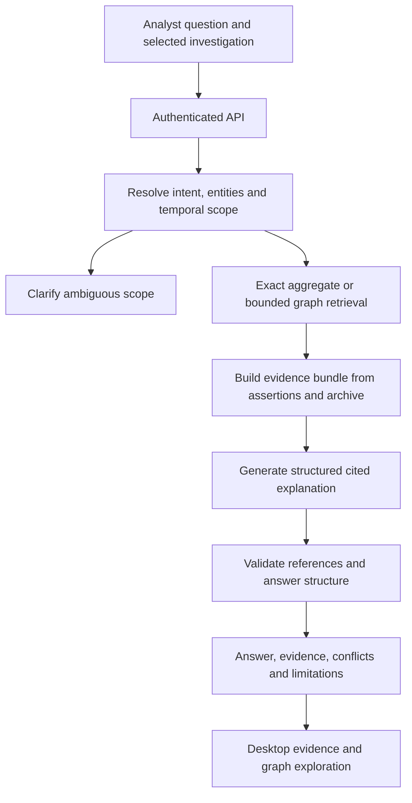

# Next-version proposal: evidence-grounded GraphRAG

Status: proposed future work only; no GraphRAG implementation or current-release
acceptance is claimed. Prepared 2026-10-30 against live-verified GitHub main
`8d4f64cf67335b938de3d4d3aaa73382ef0afde1`.

This is an explicitly requested next-version backlog. It neither extends nor
reorders the current [backend](../BACKEND_ROADMAP.md),
[desktop](../DESKTOP_ROADMAP.md) or [delivery](../ROADMAP.md) roadmap.
Package identifiers below use a separate NV namespace. The next version has no
assigned release number or delivery date. Implement only after the ingestion
readiness gate below; this document authorizes planning, not deployment or data runs.

## Purpose and architectural justification

The audience remains non-technical analysts, journalists and researchers. They
ask ordinary-language questions; Cypher is an internal execution mechanism and
an optional advanced inspection surface. The proposed layer explains findings
with inspectable evidence, relevant dates, conflicts and coverage limits.

GraphRAG here means retrieving a relevant, bounded subgraph plus the original
supporting evidence, then generating a cited explanation. It does not mean merely
using a graph database or embedding entity labels. The existing NL-to-Cypher
service generates database queries and returns structured results; it does not
currently synthesize those results into an evidence-grounded narrative answer.

The graph is useful when answering a question requires connecting entities across
sources. For example: “What evidence connects this contractor to these officials,
and how did those connections change?” A document-only search can miss a path
whose individual links occur in different records. Conversely, graph traversal
can miss evidence that extraction did not represent. Neither approach guarantees
completeness, and a connection is not proof of influence, causation or misconduct.

Expected benefits, to be tested rather than assumed:

- Explain multi-source relationships in language the intended audience understands.
- Connect each material statement to its assertions and original records or passages.
- Support follow-up investigation with explicit entity and time context.
- Reuse the archive, ontology, graph, authentication and API rather than build a
  parallel ingestion system or introduce an unjustified vector store.
- Demonstrate a justified retrieval-and-generation design with measurable tradeoffs.
  Portfolio value is secondary to a defensible use case and evidence of behavior.

The additional model call adds latency, cost and another error surface. Retrieval
cannot repair missing ingestion, incorrect extraction or mistaken entity identity.
A cited answer may still misrepresent a source. Fluent prose is not acceptance evidence.

## Proposed flow and ownership

- The API owns interactive orchestration. Infrastructure construction remains in
  `composition.py` with the existing documented API startup exception. Do not move
  provider credentials, extraction, retrieval logic or database access into desktop.
- Reuse `nlq/service.py`, `nlq/validate.py` and `nlq/plan.py` where applicable.
  Retrieval templates also need bounded, parameterized reads and independent
  read-session enforcement. Never treat a model's query as authorized by its prompt.
- Exact counts, arithmetic and dates come from deterministic database computation.
  A natural-language explanation may describe them but must not recompute a total
  from a truncated evidence sample. Mixed questions can use both branches.
- The evidence builder consumes graph assertions, qualified news claims,
  enrichment observations and original archived evidence. Structured registry
  records are legitimate evidence; do not fabricate prose or require text for all sources.
- The answer generator uses the existing model-client/version/accounting patterns.
  Its outputs are derived presentation artifacts, never new source assertions.
- Expensive offline preparation, if justified later, uses the existing bounded
  operator-job mechanism. No additional runtime service is assumed.

## Boundaries and failure semantics

Preserve valid time separately from recorded/belief time, unknown dates, interval
precision, denials, proposals, attribution, corrections and retractions. Source
trust, extraction confidence, identity-match score and answer support are different
concepts; none is a calibrated probability that a claim is true.

Preserve source dependence and dispatch/syndication lineage. Several dependent
reports are not several independent confirmations. Do not silently resolve a
conflict by dropping the lower-ranked source. A missing path or empty query is
absence in the acquired graph, not proof that no real-world relationship exists.

Source text and tool results are untrusted data. They cannot change instructions,
trigger acquisition, invoke tools or expand authorization. Query-time synthesis
must not fetch external URLs or ingest new material implicitly. Existing provider
retention, attribution and licensing obligations continue to apply to excerpts.

Use explicit outcomes: answered, partial, clarification needed, insufficient
evidence and failed. Provider timeout, invalid citations or missing archives must
not become a confident answer. Return available structured evidence when safe,
with the failure visible. Never equate syntactic citation validation with semantic
entailment or factual correctness.

Community detection, corpus-wide precomputed summaries, autonomous research agents,
new databases, multi-user account architecture and exhaustive causal inference
are outside the initial proposal. Revisit community summaries only if real global
questions beat simpler retrieval under measured freshness and maintenance costs.
Document embeddings or a hybrid passage index require a measured retrieval gap;
the existing entity-label vector index is not a document retrieval index.

## Entry gate: stable ingestion, with scoped evidence

Before NV-BE-01 implementation, record the deployed or test candidate revision,
selected supported sources and a reproducible successful acquisition-to-evidence
workflow. Check repeated ingestion/idempotency, bounded catch-up/checkpoints,
explicit partial failures, archive retrieval and claim provenance. Carry forward
upstream availability and operational gaps from [OPEN_ISSUES](../../OPEN_ISSUES.md).
A local suite pass or an operator-evidence waiver does not establish production
stability. Stability can be qualified for a named source subset; do not claim all
sources work because one scenario works. Freeze that supported scope for the pilot.

## Package sequence and completion contract

All packages are TODO. Each is a complete delivery with its own checklist,
reviewable change and evidence; internal steps are not separate deliveries.
Backend and desktop work are paired when necessary to deliver a usable feature.
Do not add these packages to the current-release sequence implicitly.

### NV-BE-01 — Establish use cases, baselines and the answer contract

Depends on: the scoped ingestion entry gate.

- [ ] Select representative investigation questions with intended users: exact
  totals, cross-source connections, changes over time, ambiguity, conflicting
  reports and unanswerable questions. Separate development and held-out questions.
- [ ] Record the current structured-query experience and define a document-only
  retrieval baseline where the evidence permits a fair comparison.
- [ ] Specify versioned request/response models: request ID, scope, selected entity
  IDs, both time axes, answer status, statements, evidence references, conflicts,
  limitations, retrieval coverage and model/prompt/retrieval versions.
- [ ] Define an evidence bundle with assertion/claim IDs, canonical entity IDs,
  source and archive hashes, available member/row/span locators, qualifier/time
  fields, lineage, missing-evidence markers and truncation diagnostics.
- [ ] Set numeric quality, latency and cost targets before implementation; record
  corpus scope, labeling rubric and who adjudicates disagreements. Numbers must
  follow pilot needs, not an arbitrary test quota.

Acceptance: a reviewed contract and evaluation protocol with answerable,
unanswerable and ambiguous examples; each reference answer identifies supporting
and contradicting evidence. Publish baseline measurements or label unavailable
measurements explicitly. Do not tune prompts on held-out evaluation questions.

### NV-BE-02 — Retrieve bounded graph paths and original evidence

Depends on: NV-BE-01.

- [ ] Resolve entities using existing identity/search facilities; clarify ambiguous
  candidates rather than silently selecting the first match.
- [ ] Retrieve typed paths with explicit maximum hops, rows, evidence items, text
  bytes/tokens and execution time. Rank relevance without claiming exhaustive coverage.
- [ ] Apply valid/belief filters consistently, retain conflict and dependence
  metadata, and prevent combining links from incompatible time periods.
- [ ] Join paths to source assertions, news spans and structured archive locators;
  preserve missing or truncated evidence instead of manufacturing replacements.
- [ ] Compute exact aggregates independently from bounded explanatory samples.
- [ ] Record the selected evidence manifest and scope. Detect concurrent graph
  changes across retrieval steps using a coherent read or explicit consistency
  checks; never claim a snapshot merely because each individual query succeeded.

Acceptance: disposable graph scenarios prove multi-source path retrieval,
ambiguous identities, temporal incompatibility, corrections, dependent reports,
missing archive material, bounded traversal and correct aggregate/sample separation.
Trace every returned citation locator to the expected original bytes or record.
No graph writes or external acquisition occur through this read path.

### NV-BE-03 — Generate and validate supported explanations

Depends on: NV-BE-02.

- [ ] Generate structured statements referencing only IDs in the evidence bundle;
  distinguish retrieved assertions, attributed reports and interpretive synthesis.
- [ ] Preserve attribution, negation, uncertainty and both time axes. Report
  contradictory evidence and known coverage limits explicitly.
- [ ] Validate output schema, citation membership, locators and required references
  on material claims. Treat these checks as necessary but insufficient for support.
- [ ] Bound provider time, output length and retry count; support partial and
  insufficient-evidence outcomes, with visible provider/validation failures.
- [ ] Record passive usage/cost and versioned provenance without logging secrets
  or unnecessary raw evidence. No new monetary governor is implied.
- [ ] Define cache invalidation using evidence content/versions, scope, query,
  temporal filters, model, prompt and retrieval versions. Account for new evidence
  that changes retrieval membership; a hash of old selected evidence alone is insufficient.

Acceptance: mocked provider tests cover invented references, unsupported certainty,
source-text prompt injection, malformed output, timeouts and abstention. Human
review on the agreed corpus checks actual entailment and qualifier preservation.
A model-based evaluator alone cannot certify faithfulness. Generated prose never
enters the graph as an authoritative source assertion.

### NV-DC-01 — Deliver the non-technical answer and follow-up experience

Depends on: NV-BE-03; deliver backend/API and desktop changes together as needed.

- [ ] Show readable answers with nearby citations, visible partial/uncertain states,
  and explicit distinctions between reported claims and established source records.
- [ ] Open citations into the existing evidence view and relevant graph context;
  preserve exact record/span locators and missing-evidence explanations.
- [ ] Carry explicit entity/time selections into follow-ups. Bound conversational
  history; new questions retrieve fresh evidence rather than treating prior prose as evidence.
- [ ] Offer plain-language disambiguation. Keep Cypher available as an optional
  advanced inspection detail, never a prerequisite for asking ordinary questions.
- [ ] Keep requests asynchronous/cancellable; scope late replies to their request,
  clear stale evidence on failure, and preserve authenticated API-only access.

Acceptance: actual-widget/API scenarios exercise a question, cited evidence,
conflicting report, temporal follow-up, ambiguity, cancellation and provider failure.
Representative non-technical users can locate the evidence and explain the answer's
limits without reading Cypher. Record observed usability, not just rendered widgets.

### NV-BE-04 — Evaluate incremental benefit and qualify release

Depends on: NV-BE-03 and NV-DC-01.

- [ ] Compare existing structured queries, document-only retrieval where applicable,
  and graph-plus-evidence synthesis on the frozen held-out question set.
- [ ] Separate retrieval recall, answer correctness, citation precision/completeness,
  unsupported-claim rate, temporal/negation errors and abstention quality.
- [ ] Measure task success and time to inspect evidence with intended users; report
  corpus size, source scope, model/version, uncertainty and sample limitations.
- [ ] Measure end-to-end latency distributions, provider usage/cost and added
  maintenance burden. Separate retrieval, generation and validation time.
- [ ] Document failure cases and rollout/disable behavior. Retain exact structured
  queries and evidence inspection when the answer-generation feature is unavailable.

Acceptance: the thresholds established in NV-BE-01 pass on held-out evidence and
scoped user tasks, or the feature remains experimental/disabled with findings
published. Release notes state supported question/source classes and remaining
operational gaps. No claim of superiority follows solely from an attractive demo.

## Promotion and revisit decisions

Promote this proposal only through an explicit next-version planning decision.
Reconcile API schemas, core/desktop contracts and the relevant release roadmap at
that point. Do not edit generated current-runtime documents to imply this exists.
A no-go evaluation is a valid engineering result: keep exact querying and evidence
navigation if synthesis adds insufficient benefit or unacceptable errors.
